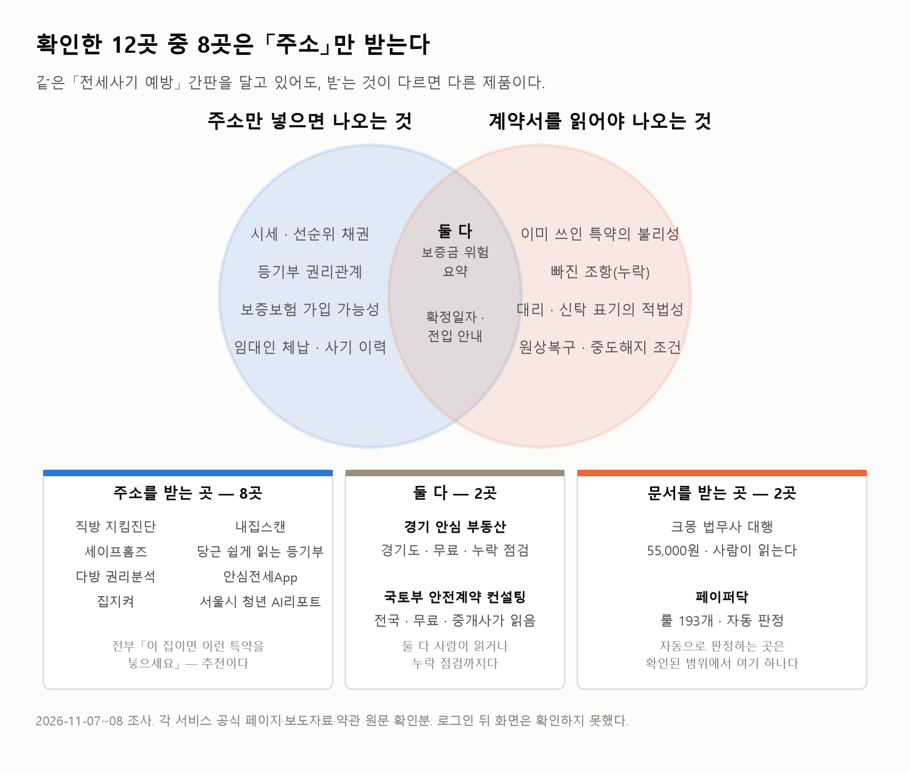
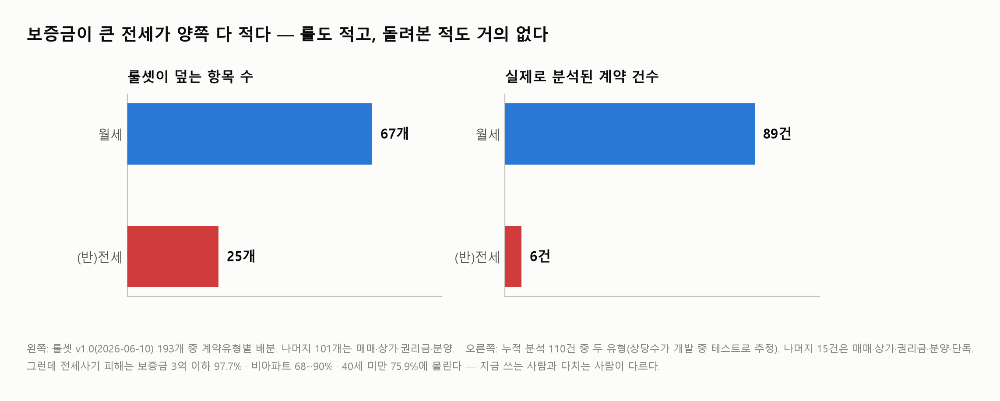
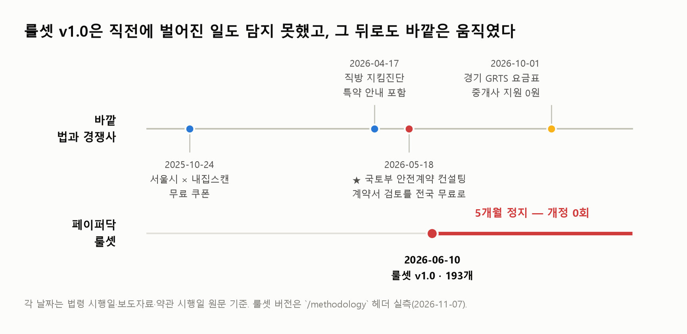
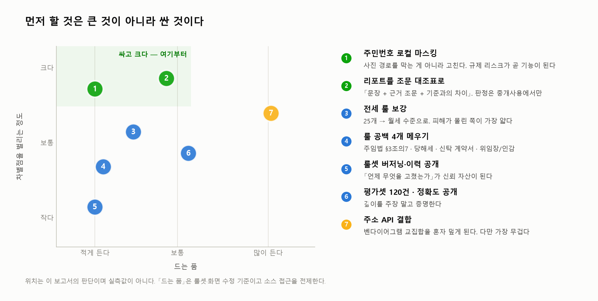
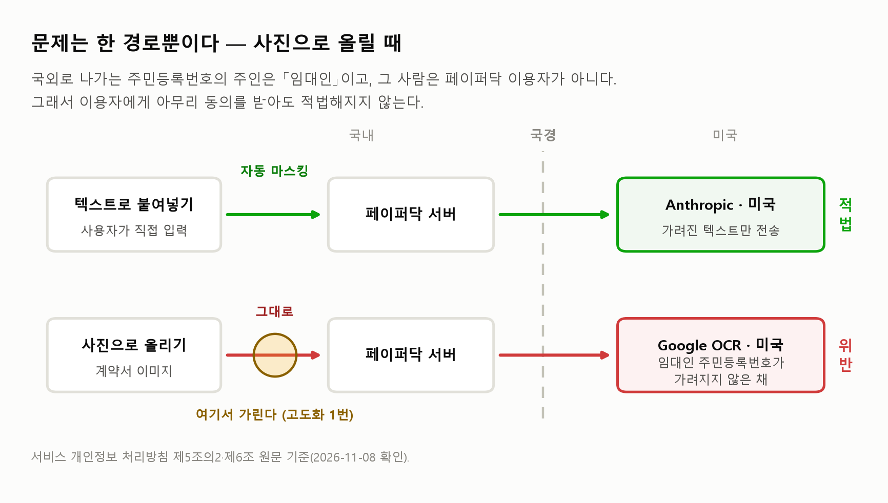
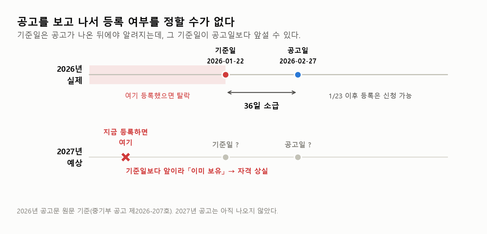

<div class="kicker">쉬운계약 페이퍼닥 · 아이템 진단</div>

# 모두가 주소를 받을 때,<br>혼자 계약서를 받는다

<p class="lead">아이템 자체만 본다 — 무엇이 강하고, 무엇이 약하고, 무엇을 고치면 되는가.<br>유입·결제 같은 내부 운영 점검은 이번 보고서에서 뺐다.</p>

<div class="meta">
<div><b>작성</b> 2026년 11월 8일 · <b>초판</b></div>
<div><b>대상</b> 쉬운계약 페이퍼닥 (paperdoc-web.vercel.app) — <b>아이템으로서의 평가</b></div>
<div><b>전제</b> 법인 귀속·지분·분사 문제는 범위 밖이다. <b>「양정호」 개인이 개인사업자로 이 아이템을 든다</b>고 가정한다</div>
<div><b>가정</b> 엔진과 룰셋 193개를 <b>계속 쓸 수 있다</b>고 본다. 이 가정이 깨지면 §5와 §8은 성립하지 않는다</div>
<div><b>방식</b> 2026-11-07 시장조사(에이전트 4기) + 법령 전수 점검 + 창업 경로 조사 + 기술 조사</div>
</div>

---

## 0. 한 장 요약

<div class="stats" markdown="1">
<div class="stat blue" markdown="1"><b>193</b><span>룰 점검 항목</span><small>v1.0 · 2026-06-10</small></div>
<div class="stat good" markdown="1"><b>4 / 12</b><span>계약서를 읽는 곳</span><small>그중 자동 판정은 1곳</small></div>
<div class="stat bad" markdown="1"><b>25</b><span>전세 룰</span><small>월세는 67개</small></div>
<div class="stat bad" markdown="1"><b>−38.0%</b><span>신규 전세 계약</span><small>서울 아파트 · 2026년 1~8월</small></div>
</div>

| 질문 | 답 |
|---|---|
| **무엇이 다른가** | 경쟁사는 거의 다 **주소**를 받는다. 페이퍼닥은 **계약서 문서**를 받는다. 이 한 가지 차이가 전부다 |
| **그게 왜 중요한가** | 주소로는 **추천**("이런 특약을 넣으세요")까지만 된다. **판정**("이미 쓰인 이 문장이 불리하다")은 문서를 읽어야 나온다 |
| **가장 큰 강점** | 그 판정을 **자동으로** 하는 곳이 확인된 범위에서 여기 하나다. 그리고 **이미 돌아가는 엔진**이다 — 만들겠다는 계획이 아니다 |
| **가장 큰 약점** | 정작 **피해가 몰린 전세의 룰이 가장 얇다**(25개). 그리고 룰셋이 **5개월째 멈춰 있다** |
| **가장 싼 고도화** | ① 사진 속 주민번호를 **보내기 전에** 가린다 ② 리포트를 「문장 + 근거 조문 + 기준과의 차이」 세 줄로 바꾼다 |
| **시장은** | **줄고 있다.** 신규 전세 −38.0%, 보증사고 −53.1%. **서두를 기한은 길어야 12개월** |
| **누구에게 파나** | **임차인이 아니라 공인중개사다.** 2026-05-18부터 국토부가 계약서 검토를 전국 무료로 깔았고, **그 상담을 공인중개사가 한다**(§2-1) |
| ⏰ **지금 걸린 시한** | **사업자등록을 미뤄라.** 2027 예비창업패키지 기준일이 공고일보다 앞설 수 있다(2026년엔 **36일 소급**) — 지금 등록하면 **자격을 잃을 수 있다**(§7-1) |
| ⚖️ **법으로 급한 것** | **사진(OCR) 경로.** 임대인 주민번호 국외 이전은 **빠져나갈 조항이 없고**, 매출이 없으면 과징금 상한이 **20억원**으로 올라간다(§6-3) |
| 🤖 **AI 쓰나** | **쓴다.** 처리방침이 **Anthropic**(특약 해석)·**Google**(OCR)을 국외 수탁자로 명시한다 → **AI기본법 §31① 적용 확정**, 고지 한 줄 누락이 3천만원(§6-5-1) |

> ### 한 문장으로
> **아이템은 서 있다. 서 있는 자리가 좁을 뿐이다.**
> 넓힐 방법은 기능을 더 얹는 게 아니라, **지금 가진 한 가지 차이를 증명하는 것**이다 — 「문서를 읽어 판정한다」를 전세 계약서로, 정확도 숫자로. 그리고 그 증명을 **임차인이 아니라 설명의무를 진 공인중개사에게** 보여 주는 것이다.

### 멈출 기준 — 미리 정해 두는 편이 낫다

**셋 중 하나라도 ✕가 나오면 접는다.**

<div class="cards three" markdown="1">
<div class="card warn" markdown="1">
<span class="tag">기준 1 · 법</span>
#### 「중개사용 도구는 법률사무가 아니다」
변호사 자문에서 이 답을 못 받으면, **개인사업자는 무한책임이라 들고 갈 수 없다**(§7-7 2단계).
</div>
<div class="card warn" markdown="1">
<span class="tag">기준 2 · 수요</span>
#### 2027-09까지 유료 중개업소
한 곳도 돈을 안 내면 **「판정이 맞으면 산다」는 전제가 틀린 것**이다(§7-7 5단계).
</div>
<div class="card warn" markdown="1">
<span class="tag">기준 3 · 자산</span>
#### 엔진·룰셋 193개의 사용권
못 쓰게 되면 **§5 고도화와 §8 기술이 통째로 무너진다.** 표지의 「가정」이 이것이다.
</div>
</div>

---

## 1. 이 제품이 하는 일 — 세 줄로

<div class="cards three" markdown="1">
<div class="card up" markdown="1">
<span class="tag">1 · 받는다</span>
#### 계약서 전문
사용자가 **임대차 계약서를 통째로** 올린다. 주소도, 등기부도 아니다. 이미 쓰인 **문장**이 입력이다.
</div>
<div class="card up" markdown="1">
<span class="tag">2 · 읽는다</span>
#### 룰 193개로 대조
계약유형별(월세·전세·매매·상가·권리금·분양 등)로 갈라, 조항과 특약을 **법령 기반 점검표**에 하나씩 맞춰 본다.
</div>
<div class="card up" markdown="1">
<span class="tag">3 · 판정한다</span>
#### 불리한 문장 지목
「이 조항이 임차인에게 불리하다」와 **그 근거 법령**을 붙여 리포트로 낸다. 사람이 읽지 않는다 — 전부 자동이다.
</div>
</div>

**비유하자면 이렇다.** 경쟁 서비스들은 **집 주소를 듣고 그 동네가 위험한지** 알려준다. 페이퍼닥은 **당신이 서명하려는 종이를 읽고, 거기 쓰인 문장이 당신에게 불리한지** 알려준다. 둘 다 「전세사기 예방」이라는 같은 간판을 달고 있지만, **받는 것이 다르면 다른 제품이다.**

---

## 2. 경쟁 지도 — 주소를 받는 8곳, 계약서를 읽는 4곳, 자동으로 판정하는 1곳

{: .narrow }

<p class="cap">왼쪽 원과 오른쪽 원은 「무엇을 입력으로 받느냐」로 갈린다. 아래 세 칸은 2026-11-07 기준 실제 서비스 배치다.</p>

**확인한 12곳을 입력 축으로 세워 보면 그림이 단순해진다.**

| 입력 | 낼 수 있는 답 | 누가 있나 |
|---|---|---|
| **주소** | 「이 집은 위험도 B다」 · 「이런 특약을 넣으세요」 — **추천** | 직방 지킴진단 · 내집스캔 · 세이프홈즈 · 당근 · 다방 · 안심전세App · 집지켜 · 서울시 청년 AI리포트 **(8곳)** |
| **주소 + 문서** | 추천 + 「빠진 항목이 있다」 — **누락 점검** | 경기 안심 부동산(경기도·무료) · **국토부 안전계약 컨설팅(전국·무료·사람)** **(2곳)** |
| **문서** | 「이미 쓰인 이 문장이 불리하다」 — **판정** | 크몽 법무사 대행(55,000원·사람) · **페이퍼닥(자동)** **(2곳)** |

> **오른쪽 칸이 좁은 것 자체는 나쁜 소식이 아니다.** 좁아서 아무도 안 들어온 게 아니라, **들어오려면 룰셋이 필요해서** 안 들어온 것이다. 주소 기반 추천은 물건 데이터를 사면 되지만, 문장 판정은 **193개를 직접 써야** 한다(§3 끝의 「대체재가 없다」 참조).

**다만 「유일하다」는 말에는 각주가 둘 붙는다.**

⑴ **내집스캔·직방도 특약을 다루긴 한다.** 내집스캔의 항목명은 **「사기 유형별 특약 안내」** — 기준이 **사기 유형**이지 사용자가 낸 문장이 아니고, 운영사가 입력을 **"주소만 넣으면"**이라고 직접 쓴다. 직방은 **"반드시 포함해야 할 구체적 특약 조건까지 안내"**라고만 해서 **판단 기준을 밝히지 않았다.**
⑵ 확인한 범위는 **로그인 전 공개 화면까지**다. 로그인 뒤 리포트 실물은 못 봤다.

### 2-1. ★ 2026년 5월, 국토부가 「계약서 검토」를 전국 무료로 깔았다

조사 중 **가장 늦게 나왔고 가장 크게 바꾸는 사실**이라 따로 적는다.
*여기서부터 **B2C**(임차인 개인에게 판다)와 **B2B**(공인중개사 같은 사업자에게 판다)를 구분해 쓴다.*

| 항목 | 내용 |
|---|---|
| 이름 | **안전계약 컨설팅** |
| 시행 | **2026년 5월 18일** |
| 무엇을 | 임대차 목적물 **권리관계 분석 + 계약서 검토 + 주의사항 상담** |
| 어디서 | 전국 **8개 전세피해 및 예방지원센터**. 이후 대학교·군부대 찾아가는 상담 추진 |
| 누가 | 한국공인중개사협회 추천 → **국토부가 위촉한 공인중개사** |
| 값 | **무료** |
| 근거 | 2026-05-12 공포 전세사기특별법 개정 |

*출처: KDI 경제정보센터 게재 국토부 보도자료. **국토부 원문 페이지는 못 찾아 KDI 게재본과 언론으로 확인했다.***

**이건 칼날이 양쪽으로 서 있다.**

<div class="cards" markdown="1">
<div class="card bad" markdown="1">
<span class="tag">위협</span>
#### B2C 유료화의 천장이 내려갔다
페이퍼닥이 유일한 차별점으로 삼은 **「계약서를 읽는다」가 공짜로 제공되기 시작했다.** 임차인에게 3,900원을 받는 그림은 여기서 한 번 더 어려워진다.
</div>
<div class="card good" markdown="1">
<span class="tag">기회</span>
#### 유료 고객이 정책으로 만들어졌다
그 상담을 **공인중개사가 수행한다.** 센터 8곳 + 찾아가는 상담으로 늘면, **그 사람들이 계약서를 빨리 훑을 도구**가 필요해진다. 페이퍼닥이 들어갈 자리가 그곳이다.
</div>
</div>

> **그래서 파는 대상이 바뀐다 — 「임차인용 진단 서비스」가 아니라 「상담하는 공인중개사가 쓰는 193개 룰 체크리스트 엔진」이다.**
> 이 포지션은 §6의 법적 위험도 가장 낮다. **최종 판단과 설명 책임이 자격사에게 남기 때문**이다.

---

## 3. 강점 — 네 가지

<div class="cards" markdown="1">
<div class="card good" markdown="1">
<span class="tag">강점 1</span>
#### 입력이 다르다
확인한 **12곳 중 8곳이 주소만** 받는다. 계약서를 읽는 곳은 **넷뿐**이고, 그중 **자동으로 판정하는 곳은 페이퍼닥 하나**다. 마케팅이 아니라 **제품 구조로 갈린 차이**라 베끼는 데 시간이 든다.
</div>
<div class="card good" markdown="1">
<span class="tag">강점 2</span>
#### 깊이가 이미 있다
**193개 항목 · 계약유형별 분기 · 근거 법령 표기.** 비교하면 내집스캔 리포트는 주택 13종 + 집주인 11종, 직방은 6개 항목이다. 「많다」가 아니라 **「문장 단위로 내려가 있다」**는 게 핵심이다.
</div>
<div class="card good" markdown="1">
<span class="tag">강점 3</span>
#### 추천이 아니라 판정이다
추천은 틀려도 손해가 없다(안 넣으면 그만). 판정은 **맞으면 돈을 아껴 준다**. 임차인에게도, 설명의무를 진 중개사에게도 **행동을 바꾸는 쪽**은 판정이다.
</div>
<div class="card good" markdown="1">
<span class="tag">강점 4</span>
#### 아이디어가 아니라 돌아가는 엔진이다
계약서를 넣으면 리포트가 끝까지 나온다. 누적 **110건**이 실제로 처리됐다(*상당수는 개발 중 테스트로 추정*). 사업계획서에서 「만들겠다」와 「돌고 있다」는 전혀 다른 칸이고, **이미 뒤쪽 칸에 있다.**
</div>
</div>

### 강점을 뒷받침하는 사실 하나 — 가져다 쓸 대체재가 없다

기술 조사(§8)에서 **한국어 계약서 불리조항을 탐지하는 오픈소스·데이터셋을 하나도 찾지 못했다.** GitHub에도 논문에도 없고, 존재하는 것은 전부 영어 전용(CUAD · CLAUDETTE · UNFAIR-ToS)이다. 한국 법률 벤치마크(LBox · KCL)는 **법률 일반 능력**을 재지 계약 조항 불리성을 재지 않고, 그나마 KCL은 **비상업 라이선스**라 상용 서비스에는 못 쓴다.

> **즉 경쟁자가 「계약서를 읽는 쪽」으로 넘어오려 해도 가져다 쓸 공개 자산이 없다.**
> 193개를 직접 써야 한다. **강점 1의 해자가 얼마나 깊은지를 재는 숫자가 이것이다.**

---

## 4. 약점 — 여섯 가지

<div class="cards three" markdown="1">
<div class="card bad" markdown="1">
<span class="tag">약점 1</span>
#### 룰이 위험과 반비례한다
보증금이 큰 전세 룰이 **25개**, 월세가 **67개**. 피해는 전세에 몰리는데 두꺼워야 할 쪽이 얇다.
</div>
<div class="card bad" markdown="1">
<span class="tag">약점 2</span>
#### 룰셋이 5개월째 멈췄다
`v1.0 · 2026-06-10` 그대로. 그사이 바깥에선 법과 경쟁사가 계속 움직였다.
</div>
<div class="card bad" markdown="1">
<span class="tag">약점 3</span>
#### 비어 있는 룰 4개
주임법 §3조의7 · **당해세** · 신탁부동산 **계약서** 룰 · 대리인 위임장/인감 — 전부 0건이다.
</div>
<div class="card bad" markdown="1">
<span class="tag">약점 4</span>
#### 깊이를 보여줄 화면이 없다
무료 샘플 **0건**이고, 홈 화면에 **제품을 설명하는 제목 문장이 하나도 없다.** 193개를 가졌다는 걸 **보여 주기 전에 떠난다.**
</div>
<div class="card bad" markdown="1">
<span class="tag">약점 5</span>
#### 사진 경로가 법을 건드린다
사진으로 올리면 계약 **상대방의 주민등록번호가 가려지지 않은 채 국외로** 나간다. 빠져나갈 조항이 **하나도 없고**, 제재가 과태료에 그치지 않고 **과징금**까지 간다(§6-3).
</div>
<div class="card bad" markdown="1">
<span class="tag">약점 6</span>
#### 정확한지 재 본 적이 없다
정답지도, 평가셋도, 공개된 정확도도 없다. **깊이는 지금 주장일 뿐 증거가 아니다.**
</div>
</div>

### 4-1. 가장 치명적인 것 — 두꺼워야 할 쪽이 얇다



<p class="cap">왼쪽은 룰셋이 계약유형별로 덮는 항목 수, 오른쪽은 실제로 분석된 계약 건수. 두 그림이 같은 방향으로 기울어 있다.</p>

보증금 2억짜리 전세는 보증금 1,000만원짜리 월세보다 **걸린 돈이 20배**인데, 그걸 지키는 룰은 **월세 룰의 37%**(25개 대 67개)다. 그리고 실제로 돌아간 계약도 월세 89건 대 전세 6건이다.

> **110건의 상당수는 사용자가 아니라 개발 중 테스트의 흔적으로 추정된다(85%).** 그렇다면 이 분포는 「사용자가 고른 것」이 아니라 **「만든 사람이 돌려 본 것」**에 가깝다. **그런데 그 경우에도 결론은 같다** — 만든 사람조차 전세를 거의 안 돌려 봤다는 뜻이 되기 때문이다.

> **이건 「사용자가 적다」는 문제가 아니라 「제품이 겨냥을 잘못했다」는 문제다.** 전세사기 피해는 보증금 3억 이하 **97.7%**, 비아파트 **68~90%**, 40세 미만 **75.9%** — 전부 전세 쪽이다. **지금 쓰는 사람과 다치는 사람이 다르다.**

### 4-2. 그리고 룰셋이 멈춰 있는 동안 바깥은 움직였다



<p class="cap">위 레인은 법 시행일·보도자료·약관 시행일 원문 기준, 아래 레인은 `/methodology` 헤더 실측(2026-11-07).</p>

정지 자체보다 **정지한 자리**가 문제다. 2026년 4월에 직방이 특약 안내를 넣었고, 10월에 경기도가 중개사 도구를 **0원**으로 깔았다. **룰셋이 가만히 있는 동안 비교 대상이 올라왔다.**

---

## 5. 고도화 — 먼저 할 것은 큰 것이 아니라 싼 것이다



<p class="cap">가로는 드는 품, 세로는 차별점을 벌리는 정도. 위치는 이 보고서의 판단이며 실측값이 아니다.</p>

| # | 할 일 | 무엇을 푸는가 | 왜 이 순서인가 |
|---|---|---|---|
| **1** | **주민번호 로컬 마스킹** — 업로드 직후 단말/서버 안에서 가려 보낸다 | 약점 5 | **규제 리스크가 그대로 기능이 된다.** 「상대방 주민번호는 서버로 나가지 않습니다」는 경쟁사가 못 쓰는 문장이다 |
| **2** | **리포트를 조문 대조표로** — 「문장 + 근거 조문 + 기준과의 차이」 세 줄 | 강점 3 강화 | 추천형과 갈리는 지점. **「불리하다」 판정은 중개사용(B2B)에서만** 쓴다 — 이유는 §6-7 |
| **3** | **전세 룰 보강** — 25개를 월세 수준으로 | 약점 1 | 피해가 몰린 쪽이 가장 얇다. 겨냥을 돌리는 일이라 뒤로 못 민다 |
| **4** | **공백 4개 메우기** — 주임법 §3조의7 · 당해세 · 신탁 계약서 · 위임장/인감 | 약점 3 | 넷 다 **이미 어디가 빈지 알고 있다.** 넣을 때 **조문 + 제재 유무 + 단서까지** 같이 넣는다(§6-8) |
| **5** | **룰셋 버저닝 · 개정 이력 공개** | 약점 2 | 「언제 무엇을 왜 고쳤는가」가 쌓이면 **그 자체가 신뢰 자산**이 된다. 경쟁사는 공개하지 않는다 |
| **6** | **평가셋 120건 + 정확도 공개** (계약유형 6종 × 20건) | 약점 6 | 깊이를 **주장하지 말고 증명한다.** B2B 납품에서 반드시 요구받는 숫자다 |
| **7** | **주소 API 결합**(등기·체납·시세) | 벤다이어그램 교집합 | 성공하면 **교집합 전체를 혼자 덮는 유일한 제품**이 된다. 다만 가장 무겁고, 1~6 다음이다 |

> **1·2번만 해도 제품의 말이 바뀐다.** 지금은 「계약서를 분석해 드립니다」인데, 그 뒤엔 **「제3조 특약 — 주택임대차보호법 제10조는 이렇게 정한다. 이 문장은 그 기준과 이만큼 다르다.」** 가 된다. 같은 엔진으로 나오는 문장인데 파는 물건이 달라진다.

**1~6번을 혼자 하면 얼마나 걸리나.** 비용이 확인된 건 셋뿐이다 — **주민번호 마스킹 1~2일**, **AI 고지 한 줄**, **「193개」 실증 파일 반나절**(§6-7). 나머지 넷(전세 룰 보강 · 공백 4개 · 버저닝 · 평가셋 120건)은 **이번 조사로는 공수를 추정하지 못했다.** 작게 잡아도 전세 룰과 평가셋이 각각 몇 주 단위다.

---

## 6. 법으로 걸리는 것 — 전수 점검

**조문 96건을 원문으로 받아 범주별로 훑었다.** 법제처 OPEN API는 **뚫지 못했다**(`OC=test`·개인 ID 둘 다 "서버 IP를 등록해 주세요"로 거부 — 계정 문제가 아니라 **호출 IP 사전등록** 문제다). 대신 국가법령정보센터 `robots.txt`가 전면 허용이라 조문 원문을 직접 받았다. **이 절의 조문은 전부 그 경로이고, API로 받은 것은 하나도 없다.**

### 6-1. 위험도 순

**표를 읽기 전에.** **「확정」은 조문 문언만으로 결론이 나는 것**이고, **퍼센트는 이 보고서의 주관적 확신도**다 — 「유력 75%」는 적용될 가능성이 75%, 「비해당 70%」는 적용되지 **않을** 가능성이 70%라는 뜻이다.

| # | 법령·조문 <br><span style="font-weight:400">— 쉬운 말로</span> | 무엇이 걸리나 | 위험도 |
|---|---|---|---|
| **1** | 개인정보보호법 **§28조의8①**<br>*개인정보를 해외 서버로 보낼 때의 규칙* | 임대인 주민번호의 국외 이전 — **빠져나갈 조항이 없다** | **확정** |
| **2** | 개인정보보호법 **§24조의2①**<br>*주민번호는 동의를 받아도 함부로 못 다룬다* | 주민번호 처리 — **동의로 치유되지 않는다** | **확정** |
| **3** | 변호사법 **§109 1호**<br>*변호사 아닌 사람이 돈 받고 법률 일을 하면 처벌* | 과금을 열면 「이익을 받고 법률관계 문서를 검토」가 된다 | 유력 **75%** |
| **4** | 변호사법 **§112 3호**<br>*돈을 안 받았어도 「법률 일을 한다」고 내걸면 처벌* | **과금 전에도** — 가격표를 공표한 것이 「표시」가 된다 | 유력 **55%** |
| **5** | 표시광고법 **§5①**<br>*광고에 쓴 숫자는 증명 자료를 갖춰야 한다* | 「총 점검 항목 193개」 — **요청받으면 15일 안에 자료를 내야 한다** | **확정** |
| **6** | 약관법 **§7 1호·2호**<br>*책임을 통째로 면하는 약관 조항은 무효* | 「법률 자문이 아니다」식 면책 조항이 **안 먹힌다** | **확정**(고의·중과실 배제분) |
| **7** | AI기본법 **§31①**<br>*생성형 AI를 쓴다는 사실을 미리 알려야 한다* | 고지 누락 시 **조사 없이 과태료 3천만원** | **확정** (LLM 사용은 §6-5-1에서 확인) |
| 8 | AI기본법 §2 4호 | **고영향 AI 비해당** (가~차 전수 검토) | 비해당 **70%** |
| 9 | 전자상거래법 §17⑥·§18② | 환불 거절의 전제 조치 미비 | 유력 60% |
| 10 | 저작권법 §93② | 법제처 DB **반복·체계적 스크래핑** | 유력 40% |
| — | **공인중개사법 전반** | **직접 적용 없음** — 페이퍼닥은 「중개」를 하지 않는다 | **비해당 확정** |
| — | 법무사법 · 세무사법 · 행정사법 · 신용정보법 | **현 구조 비해당.** 다만 기능을 넓히면 들어온다 | 비해당 확정 |

### 6-2. 변호사법 — 2026년 대법원 사건은 페이퍼닥에 **불리한** 쪽이다

직전 시장조사에서 나는 **「2026-03 대법원이 법률문서 자동작성을 기술적 도구 제공으로 봤으니 변호사법 리스크가 낮아진다」**고 썼다. **그 전제가 틀렸다. 사건을 찾아보니 방향이 반대다.**

| | 사건이 **합법**으로 본 것 | 사건이 **위법 소지**로 본 것 |
|---|---|---|
| 무엇 | 이용자가 입력한 내용을 **검토·수정 없이 그대로 채워 넣는** 자동작성 | **유료 「검토」 서비스** — "구체적·개별적 사실관계를 토대로 **대상문서를 검토하고 수정하는 과정**" |
| 페이퍼닥은 | ✕ 아니다 | ✅ **정확히 이쪽이다** |

> **페이퍼닥은 「채워 넣기」가 아니라 「검토」이고, 룰 193개를 「제출된 계약서라는 구체적·개별적 사실관계」에 적용한다.**
> 원심이 법률사무 취급의 표지로 든 특징을 그대로 갖고 있다.

같은 사건은 **「생성형 AI로 이용자 입력을 바탕으로 법률문서를 작성하면 단순 자동화를 넘어 법률사무 취급에 해당할 수 있다」**고도 했다.

**유리한 쪽은 하나뿐이다** — 이 사건에서 문제된 검토 서비스는 **제휴 변호사가 읽고 날인**하는 구조였고 그 변호사 개입이 인정의 중요 요소였다. 페이퍼닥엔 그게 없다. *다만 §109는 「변호사가 아니면서」 법률사무를 취급하는 것을 처벌하므로, 변호사가 없다는 게 방어가 되지는 않는다.*

> ⚠️ **여기 적은 내용은 전부 기사 경유이고 판결문 원문을 못 받았다.** **대법원이 자세히 심리하지 않고 그대로 확정한 사건**(심리불속행)이라, 실제 이유는 **2심 서울고법 판결문**에 있다. 법제처 판례DB에 미등재, 대법원 종합법률정보는 연결 실패. **사업계획서에 인용하기 전에 반드시 원문을 확보할 것** — 위험도 75%를 확정으로 올리거나 50%로 내리는 유일한 자료다.

### 6-3. 가장 확정적인 것 — 주민번호 국외이전은 빠져나갈 조항이 없다



<p class="cap">두 경로 중 하나만 문제다. 텍스트는 보내기 전에 가려지지만, 사진은 그대로 나간다.</p>

§28조의8①의 예외 5개를 하나씩 대 보면 **전부 막힌다.** 이유는 한 단어다 — **「정보주체」**(그 개인정보의 주인).

> 국외로 나가는 주민번호의 **정보주체는 임대인(계약 상대방)이고, 그 사람은 페이퍼닥의 이용자가 아니다.**

| 예외 | 쓸 수 있나 | 왜 |
|---|---|---|
| 1호 별도 동의 | ✕ | 동의는 **본인**에게 받아야 한다. 임대인과 접점이 없다. **이용자의 동의로 제3자의 주민번호를 보낼 수 없다** |
| 2호 법률·조약 | ✕ | 근거 법률 없음 |
| 3호 계약 이행 + 처리방침 공개 | ✕ | 문언이 「**정보주체와의** 계약」이다. **처리방침에 공개해 두는 것으로 치유되지 않는다** |
| 4호 이전받는 자의 인증 | 이론상 | 통상의 미국 OCR·LLM API는 해당하지 않는다 |
| 5호 적정성 인정 | ✕ | 미국은 동등수준 인정국이 아니다 |

**제재가 과태료가 아니라 과징금이다.** §64조의2①7호 — **전체 매출액의 3% 이내, 매출이 없거나 산정이 곤란하면 20억원 이내.**

> **과금을 안 한 게 유리하지 않다.** 매출 0이면 상한이 3%(=0원)가 아니라 **20억원**으로 올라간다.
> 그리고 처리방침이 스스로 「마스킹 없이 국외 전송」을 인정하고 있어 **사실관계를 다툴 여지도 없다.**

### 6-4. 과금을 안 해도 이미 걸릴 수 있다 — 변호사법 §112 3호

앞선 긴급점검에서 나는 **「결제를 닫아 둔 것이 공짜로 가진 유일한 방어」**라고 썼다. **절반만 맞았다.**

> **§112 3호** — 변호사가 아니면서 **「이익을 얻을 목적으로」** 법률상담이나 그 밖의 법률사무를 취급하는 **뜻을 표시 또는 기재한 자.** 3년 이하 징역 또는 2천만원 이하 벌금.

**돈을 받거나 받기로 약속할 필요가 없다.** 가격표(3,900원·9,200원)를 공표한 이상 「이익을 얻을 목적」은 다투기 어렵다. 그리고 §109가 성립하면 **§116으로 받은 금품 전액이 몰수·추징**된다.

> **그리고 이 영역에서는 법인을 세워도 소용이 없다.** 법인을 만들어도 **설계·운영한 개인이 그대로 피고인**이 된다(이유는 §7-4).

### 6-5. AI기본법 — 고영향은 아니다. 그런데 한 줄이 3천만원이다

**이미 시행 중이다**(2026-01-22). 페이퍼닥은 개인이어도 **「인공지능사업자」에 해당**한다.

**「고영향 AI」**(사람의 삶에 큰 영향을 주는 AI로 법이 따로 지정한 10개 영역)**를 전수로 대 봤고 전부 비해당이다**(유력 70%). 가장 가까운 항목은 **사목**(채용·대출 심사처럼 **개인의** 권리·의무에 중대한 영향을 주는 판단)인데, **페이퍼닥은 사람을 평가하지 않고 문서를 평가하며, 결정도 내리지 않는다.**

**그런데 제재 구조가 비대칭이다.**

| 의무 | 제재 경로 |
|---|---|
| **§31① 생성형 AI 이용 사실 사전 고지** | **§43①1호 → 조사 없이 즉시 과태료 3천만원** |
| §31② 결과물 표시 · §32 · §34 | §40 사실조사 → 시정명령 → 불이행 시 제재 (**2단**) |

> **즉 지금 당장 돈이 나갈 수 있는 건 「결제 전 화면에 AI 이용 사실 한 줄」 하나다.** 부칙에 유예 규정은 없고, 보도된 「최소 1년 유예」는 **행정 계도기간**이지 법적 면제가 아니다.

⚠️ **잔여 불확실성 하나.** **시행령 §2 4호 카목에 「주거·부동산」이 들어가면 고영향 비해당 결론이 뒤집힌다** — 시행령 원문 미확보.

### 6-5-1. ✅ 「LLM을 쓰는가」 — 확인했다. 쓴다

보고서를 쓰는 동안 이 질문이 열려 있었다. **서비스 자신의 공개 문서로 닫혔다.**

**개인정보 처리방침 제6조 — 국외 이전 수탁자 명단**

| 수탁자 | 국가 | 목적(원문) |
|---|---|---|
| **Anthropic, PBC** | 미국 | **핵심 항목(문서유형·금액·면적·기간 등)의 구조화 추출 보조** |
| **Google LLC** | 미국 | **이미지 문자 인식(OCR)** |
| Supabase, Inc. | 미국 | 회원 인증·DB |
| Vercel, Inc. | 미국 | 호스팅·이용 통계 |

**그리고 FAQ가 더 직접적이다.**

> 「분석의 뼈대는 검수된 룰 데이터베이스입니다 … **AI는 이를 보조하는 용도로 실제 사용됩니다: 사진·이미지의 문자 인식(OCR)과 특약사항의 자연어 위험 해석 등입니다.**」

> **「특약사항의 자연어 위험 해석」은 OCR이 아니라 텍스트 이해다 — LLM 용도이고, 그 산출물이 리포트에 들어간다.**
> 하필 **특약**이다. §6-2에서 본 「생성형 AI로 법률문서를 작성하면 단순 자동화를 넘는다」는 판시와, 페이퍼닥의 **가장 핵심적인 차별점**이 같은 자리에서 만난다.

**그래서 세 가지가 확정된다.**

| | 확정 내용 |
|---|---|
| **AI기본법 §31①** | **적용된다.** 「LLM 사용 전제」가 아니라 **전제가 충족됐다.** 고지 누락 시 조사 없이 3천만원 |
| **§31① 충족 여부** | ⚠️ **미흡해 보인다.** AI 사용 고지가 **처리방침과 FAQ에만** 있고, **이용약관과 `/methodology`에는 「AI」가 0회**다. §31①은 **사전 고지**인데 FAQ에 묻힌 것으로 충족되는지 의문이다 |
| **변호사법 위험도** | **올라간다.** 룰만 쓴다는 방어선이 없다 |

**덤으로 두 가지가 더 확인됐다.**

- **국외이전의 근거로 처리방침이 적은 조문이 하필 §28조의8①3호다** — §6-3에서 **「페이퍼닥에는 작동하지 않는다」고 결론 낸 바로 그 호**다. 즉 **서비스가 스스로 밝힌 적법 근거가 성립하지 않는 구조**다.
- **회사가 위험을 알고 있고 사용자에게 넘겼다.** 처리방침 제5조의2④ — *"이미지 형태로 전송되는 경우(Google OCR)에는 이미지 내 개인정보가 마스킹 없이 전송될 수 있으므로 **반드시 사전에 직접 가려 주시기 바랍니다**."* **고지로 책임이 넘어가지 않는다** — §24조의2·§28조의8은 처리자의 의무다.

*텍스트 경로는 Anthropic 전송 전 식별정보를 **자동 마스킹한다**고 적혀 있다. 문제는 **이미지(OCR) 경로 하나**이고, 그래서 고도화 1번(클라이언트 마스킹)이 정확히 그 하나를 겨눈다.*

### 6-6. 「해당 없음」으로 확정된 것 — 그리고 그게 판매 각도다

**공인중개사법은 페이퍼닥에 직접 적용되는 조문이 없다.** §25①·§25조의3·§51②1호의6(과태료 500만원)은 **전부 "개업공인중개사"를 주체로 하는 조문**이고, 페이퍼닥은 중개(§2 1호 알선)를 하지 않으므로 등록의무도 비해당이다.

> **그래서 이 조문군은 리스크가 아니라 판매 각도다.** 500만원 과태료를 지는 사람은 중개사이고, **페이퍼닥은 그 사람의 리스크를 줄이는 도구**다. §2-1·§7-6의 B2B 방향과 정확히 맞물린다.

**법무사법·세무사법·행정사법·신용정보법도 현 구조에선 비해당**이다. 다만 **넓히면 들어온다** — 특약 **문구를 작성**해 주면 행정사법 §2①2호, 세금 계산·절세 조언을 붙이면 세무사법 §2 4호, 임대인 체납 조회를 대행하면 신용정보법 §4①(무허가 신용조사업)이다.

### 6-7. 그래서 고칠 것 여섯 <span style="font-weight:400">— 순서대로</span>

| 순위 | 변경 | 막는 조문 | 비용 |
|---|---|---|---|
| **1** | **업로드 전 클라이언트에서 주민번호 마스킹** (또는 사진 경로 폐지) | 개인정보보호법 §24조의2 · §28조의8 · §64조의2 | 프론트 **1~2일** |
| **2** | **OCR·추론을 국내 리전으로** | §28조의8 전체가 **아예 적용되지 않게** 된다 | 벤더 교체 |
| **3** | **결제 전 화면에 「생성형 AI 이용」 한 줄** ✅적용 확정 | AI기본법 §31① → 3천만원 즉시 과태료. **LLM 사용이 §6-5-1에서 확인됐다** | **문장 한 줄** |
| **4** | **출력을 「판정」에서 「조문 대조표」로** — 「불리하다」 → 「조문은 이렇게 정한다」 | 변호사법 §109 1호 · §112 3호 | 템플릿 개편 |
| **5** | **면책 문구를 「책임 배제」가 아니라 「채무 범위 한정」으로** 재작성 + 고의·중과실 유보 명시 | 약관법 §7 1호·2호·4호 | 약관 개정 |
| **6** | **「193개」 실증 파일 작성** + 숫자에 계약유형 조건 부기 | 표시광고법 §5①(요청 시 **15일 내** 제출) | 표 하나, **반나절** |

**비용 0인 것 둘** — AI기본법 §33① **고영향 사전검토서 문서화**(6-5의 검토를 그대로 문서로), **법제처 OPEN API 정식 발급**(저작권법 §93② 리스크 제거 + 조문 자동 갱신, §8-2와 같은 일).

> ### 위 표 4번(출력을 조문 대조표로)은 §5 고도화 2번과 충돌했다 — 정면으로 적는다
> 이 보고서의 초고는 판정문을 **「불리한 문장 + 근거 조문 + 대체 문안」** 세 줄로 바꾸라고 썼다. **법령 조사가 그 반대를 가리켜서 §5를 고쳤다** — 「불리하다」는 단정이 §109의 「검토」에 가깝고, **「대체 문안」은 문구 작성이라 행정사법 경계로 넘어가기 때문이다.**
>
> **둘을 화해시키는 길은 「누구에게 파는가」다.**
> **B2C**로 내보내는 출력은 **조문 대조표**여야 한다 — 「이 문장 / 해당 조문 원문 / 조문이 정한 기준과의 차이」.
> **B2B(공인중개사)** 로는 판정 보조로 그대로 쓸 수 있다 — **최종 판단과 설명 책임이 자격사에게 남기 때문**이다.
>
> **§2-1(국토부가 만든 중개사 고객), §7-6(실재하는 유일한 채널), §6-6(공인중개사법 비해당)이 전부 같은 곳을 가리킨다.**


### 6-8. 룰 공백을 메우다 새 위반을 만들 수 있다

고도화 4번(룰 공백 4개 메우기)의 첫 항목인 **주택임대차보호법 §3조의7**에는 **위반 제재 조문이 법에 없다.** §1~§31 전수 확인 결과 벌칙은 §31(공무원 의제) 하나뿐이다.

| 룰이 이렇게 쓰면 | 결과 |
|---|---|
| 「임대인이 §3조의7을 위반하면 **처벌된다**」 | 🚫 **그 출력 자체가 표시광고법 §3①1호 거짓 표시가 된다** |
| 각 호 **단서**(임대인이 **사전 열람 동의**로 갈음 가능)를 분기하지 않음 | 🚫 **적법한 계약을 불리하다고 오탐한다** |

> **룰을 메우는 일이 그 자체로 새 리스크를 만들 수 있다.** 공백 4개는 「조문을 찾아 넣는 일」이 아니라 **「조문 + 제재 유무 + 단서까지 넣는 일」**이고, §8-4의 `rule_law_link` 스키마가 필요한 실질적 이유가 여기 있다.

## 7. 개인사업자로 창업한다면

**「양정호 개인이 이 아이템을 들고 나온다」는 전제로만 봤다.** 법인 귀속·지분 문제는 다루지 않는다.

### 7-1. ★ 가장 먼저 — 지금 사업자등록을 하면 안 된다

조사 전체에서 **시한이 걸린 항목은 이것 하나**다.

예비창업패키지 자격은 「신청자 명의의 사업자등록증을 보유하고 있지 않은 자」인데, 여기 **기준일**이 붙고 **그 기준일이 공고일보다 앞설 수 있다.**

| 연도 | 공고일 | 사업자등록 판정 **기준일** | 간격 |
|---|---|---|---|
| 2025 | 2025-02-17 | 사업공고일(2025-02-17) | 0일 |
| **2026** | 2026-02-27 | **2026-01-22** | **36일 소급** |



<p class="cap">구제 조항(「기준일 다음날 이후 등록한 경우 신청 가능」)은 기준일 <b>이후</b>의 등록만 용서한다.</p>

> **그래서 「공고를 보고 나서 등록할지 정한다」가 성립하지 않는다.**

**반대로 좋은 소식 둘.**

- **재직자(겸직)를 막는 조항이 공고문·Q&A 어디에도 없다** — 제외대상 ①~⑬ 전수 확인. 겸직 금지는 주관기관 인력에만 걸린다.
- **나이 제한도 없다** — Q&A 원문 「나이 제한은 없습니다」.

**단 현실적인 걸림돌은 따로 있다.** 겸업 가능 여부 자체는 **재직 회사 취업규칙** 문제이고, 선정되면 **인큐베이팅 현장 참석 · 발표평가 본인 참석 · 1단계 사업비 4개월 집행**이 따라온다 — **재직 중이면 시간이 안 난다.**

### 7-2. 예창패와 초창패는 조건이 많이 다르다

<div class="stats three" markdown="1">
<div class="stat good" markdown="1"><b>0원</b><span>예창패 자기부담</span><small>정부지원 100%</small></div>
<div class="stat bad" markdown="1"><b>30%</b><span>초창패 자기부담(수도권)</span><small>1억 받으면 현금 1,429만</small></div>
<div class="stat bad" markdown="1"><b>−62%</b><span>예창패 선발 규모</span><small>780명(2025) → 300명 내외(2026)</small></div>
</div>

**예창패는 사업자등록이 없어야 하고, 초창패는 개인사업자가 정면 대상**이다(공고문 「개인사업자 : 사업자등록증 상 '개업연월일' 기준」). 즉 **등록해 버리면 예창패를 잃고 초창패로 갈아타는 것**이고, 그 대가가 자기부담 30%다. *2027년 공고는 아직 없고, 2026년 접수는 둘 다 끝났다.*

### 7-3. 세금 — 서울에서 시작해도 감면이 0은 아니다

조세특례제한법 제6조(**시행 2026-09-18**). 감면대상 업종에 **정보통신업**이 들어 있다 — *소프트웨어 개발·공급업이 그 하위로 읽히나, 제6조 본문에 따로 열거돼 있지는 않다.* 제외되는 「전문서비스업」은 변호사·법무사 등 **자격사 사무소**라 페이퍼닥은 무관하다.

*「과밀억제권역」은 수도권 중 인구가 몰린 지역을 법으로 묶은 것이고, **서울은 전역이 여기 해당**한다.*

| 구분 | 수도권 외 | 수도권(과밀억제권역 제외) | **서울 전역** |
|---|---|---|---|
| 청년창업 | 100% | 75% | **50%** |
| 일반창업 | 50% | 25% | **0%** |
| 일반창업 + **수입금액 1억 400만원 이하**(제6항) | 100% | 75% | **50%** |

> **과금 미개시로 출발하는 페이퍼닥은 초기 몇 해 제6항 구간에 있을 가능성이 높다 — 서울이어도 50%다.**
> 그리고 **사업장을 수도권 밖에 두면 일반창업도 50%, 청년이면 100%**다. 소재지 한 줄이 감면율을 통째로 바꾼다.

**간이과세**(매출이 작은 개인사업자에게 부가세를 덜 매기는 제도)**는 기대하지 마라.** 소프트웨어 개발·공급업은 업종 기준으로 배제될 가능성이 높다(*2차 출처, 고시 원문 미확인*). **서울·소프트웨어면 일반과세자로 보고 계획하는 쪽이 안전**하고, B2B가 주력이면 **매입세액 공제**(사업상 지출에 붙은 부가세를 돌려받는 것) 때문에 오히려 유리하다.

### 7-4. 책임 — 「법인이면 안전하다」는 지금 단계에선 틀리다

| 흔한 생각 | 실제 |
|---|---|
| "법인이면 형사책임을 피한다" | **아니다.** 형사처벌은 실제 행위자(대표자)에게 가고, 법인은 **양벌규정**(직원이 위법하면 회사도 같이 벌하는 규정)으로 **추가로** 처벌될 뿐이다 |
| "법인이면 배상에서 보호된다" | 1인 법인은 보호막이 얇다 — 은행·거래처가 **대표자 연대보증**을 요구하고, 법원이 **법인격 부인**(법인이라는 껍데기를 걷어내고 개인에게 책임을 묻는 것)을 할 수 있다. 설립·유지 비용만 먼저 나간다 |
| "개인사업자는 위험하다" | 민사 채무는 맞다 — **사업재산과 개인재산의 구분이 없다.** 판정이 틀려 이용자가 불리한 계약을 맺으면, 그 손해배상 청구가 **개인 재산으로 온다** |

**그래서 실효적인 순서는 법인화가 아니다.** ①**약관 재작성** → ②과금 개시 시점에 **배상책임보험** 검토 → ③매출·고객이 붙은 뒤 법인 전환. 전환 비용은 걱정할 게 못 된다 — 이월과세는 **부동산·기계가 있는 사업자**용 장치고 페이퍼닥엔 그런 자산이 없다.

> ⚠️ **①에서 한 가지를 정정한다.** 「법률 자문이 아니다」식 면책 문구는 **약관법 §7 1호·2호로 무효가 될 위험이 크다**(§6-1). **리스크를 줄이는 장치가 아니라 숨기는 장치**다. 써야 할 형태는 **책임 배제가 아니라 「채무 범위 한정」**이고, 고의·중과실은 명시적으로 유보해야 한다.

**그리고 변호사법 영역에서는 법인이 아예 방패가 못 된다.** 변호사법에는 **양벌규정이 없다**(§115는 법무법인 전용). 그래서 법인을 세워도 **설계·운영한 개인이 그대로 피고인**이고, 법인에 벌금을 물릴 근거조차 없다.

**법인이 필수가 되는 순간은 딱 하나 — 시드 투자다.** 개인사업자는 지분을 발행할 수 없고, 벤처기업확인의 벤처투자유형도 **자본금 개념이 없어** 쓰기 어렵다.

### 7-5. 조달 — 「개인사업자라서」 막히는 문은 거의 없다

| 열려 있다 | 막힌다 |
|---|---|
| 나라장터 입찰참가자격 등록 · 중소기업확인서 · **창업기업확인서**(창업 후 **7년까지만** 받을 수 있고, 받으면 **3년 유효**) | 지분투자 · 벤처기업확인 **벤처투자유형** |

가장 쓸모 있는 건 **창업기업제품 공공기관 우선구매 8% 의무**(창업지원법 §5조의2, 시행령 §5조의8)다 — 이게 B2G로 들어가는 문이고, 개인사업자도 열려 있다. **업력 7년 시계가 등록일부터 도니 등록 직후 바로 받아 두는 게 맞다.**

### 7-6. 판로 — 공인중개사는 있고, 지자체는 없다

<div class="cards" markdown="1">
<div class="card good" markdown="1">
<span class="tag">실재한다</span>
#### 공인중개사 B2B
국토부 안전계약 컨설팅의 **상담 주체가 공인중개사**다(§2-1). 경기도도 중개사 협업 프로젝트를 돌린다(*언론 보도 기준*). **정책이 이미 공인중개사를 계약서 설명 책임의 접점으로 지목했다.** 「업소당 월 구독」이 가장 자연스럽다.
</div>
<div class="card bad" markdown="1">
<span class="tag">근거가 없다</span>
#### 지자체 납품
서울·경기 외 **다른 지자체의 「계약서 검토 솔루션」 발주 공고를 한 건도 못 찾았다.** 확인된 서울·경기 건도 전부 **보조금·인력모집·캠페인**이고 용역 발주가 아니다. 나라장터에도 없다. **이 단계에서 쫓지 마라.**
</div>
</div>

**판로의 크기는 이렇다.** 개업공인중개사는 **108,319명**(2026년 2분기)이다. 직전 시장조사의 가격 가설(**업소당 월 29,000원**)로 계산하면 **연 1억원을 만드는 데 300곳**, 전체의 **0.28%**다. *가격은 시장가가 아니라 가설이고, 중개사 대상 SaaS 공개 요금표를 못 찾았다.*

**시장이 줄어드는데 왜 중개사인가.** 거래가 줄어도 **설명의무와 과태료는 건당 그대로**라, 중개사 쪽 수요는 거래량보다 덜 흔들린다. *다만 이건 구조에서 끌어낸 추론이고, 거래량과 중개사 지출의 상관을 실측한 자료는 없다.*

**손해보험사는 판단 보류**(임대차 계약 조항을 인수심사에 쓴다는 1차 자료를 못 찾았다), **법무사는 평가 근거 부족**이다.

### 7-7. 지금 순서대로 밟을 것

> **핵심 판단: 사업자등록은 3단계다. 1·2단계는 등록 없이 되고, 등록은 되돌릴 수 없다.**
> **그런데 그보다 앞에 0단계가 있다 — 지금 돌고 있는 서비스를 먼저 멈춰 세우는 일이다.**

| # | 무엇을 | 언제까지 | 왜 이 순서인가 |
|---|---|---|---|
| **0** | **화면 셋을 고친다.** ⑴**사진 업로드 경로를 임시로 닫거나**, 업로드 전 주민번호 마스킹을 붙인다 ⑵결제 전 화면에 **「생성형 AI 이용」 한 줄** ⑶**가격표(3,900원·9,200원)를 내린다** | **지금 (2026-11)** | 셋 다 **하루 안에 된다.** 각각 과징금 상한 20억(§6-3) · **조사 없이 과태료 3천만원**(§6-5) · 변호사법 §112 3호(§6-4)를 막는다. **서비스가 돌고 있는 한 노출은 현재진행형**이라, 등록·공고와 무관하게 이게 먼저다 |
| **1** | **등록을 보류한다.** 동시에 ⑴2027 예창패 공고를 K-Startup·기업마당에서 **주 1회 확인** ⑵2026 공고문·Q&A를 그대로 읽고 **사업계획서 10쪽 초안** 작성 | 2026-12-31 착수 | 기준일이 공고일보다 **36일 앞설 수 있다.** 예창패는 **자기부담 0원**이라 초창패(수도권 30%)보다 월등하다. 등록은 언제든 할 수 있다 — **비가역 선택을 뒤로 미루는 게 유일하게 옳은 순서다** |
| **2** | **변호사 자문 1회.** 질문을 하나로 좁힌다 — 「이미 쓰인 임대차 조항의 불리성을 **룰 기반으로 판정해 제공**하는 것이 변호사법 §109의 법률사무 취급인가. **B2C와 B2B(자격사용 도구)에서 결론이 갈리는가**」 | 2027-01 (1과 병행) | 개인사업자는 무한책임이라 이 답이 **사업 형태·약관·포지셔닝을 전부 결정**한다. 등록 전에 받아야 업종·업태·약관을 한 번에 맞춘다 |
| **3** | **예창패 결판 직후 등록.** 선정되면 공고 의무대로 협약종료 2개월 전까지, 탈락·미공고면 즉시. **등록 당일 홈택스에서 업종코드를 직접 조회** | 2027-06-30 | 예창패는 **선정 후 등록이 정상 경로**다. 미리 등록할 이득이 없다. 코드는 세액감면·1인창조기업·간이과세·동종판정 **네 군데를 동시에 건드린다** |
| **4** | **확인서 3종 묶어 발급** — 창업기업확인서 → 중소기업확인서 → 나라장터 입찰참가자격 | 등록 + 60일 | 우선구매 8% 의무로 들어가는 문이고, **업력 7년 시계가 등록일부터 돈다 — 빨리 받을수록 쓸 기간이 길다** |
| **5** | **B2B 채널 하나에 집중 — 공인중개사.** 위촉 중개사·협회·경기 안전전세 참여 업소에 「상담사용 체크리스트 엔진」으로 유료 파일럿 | 2027-09-30 | 국토부가 B2C 천장을 낮추면서 **동시에 유료 고객을 만들어 줬다.** 법적 위험도 가장 낮다. 「지자체 납품」은 **공고 실례가 0건이니 쫓지 말 것** |


## 8. 붙일 수 있는 것 — 오픈소스·공개데이터·API

**세 줄 요약.** ① **주민번호 가리기는 이미 나와 있는 공개 도구**로 된다(MIT, 무료). ② **법 개정을 자동으로 잡는 공공 API**가 있다 — 단 상업적 이용 가능 여부를 전화로 먼저 확인해야 한다. ③ **정확도 평가셋은 세상에 없어서 직접 만들어야 한다.**

*아래는 개발자가 볼 상세다.* 다만 **라이선스 칸만은 꼭 보라** — 잘못 고르면 **서비스 소스를 통째로 공개할 의무**가 생긴다.

### 8-1. 먼저 읽을 칸 — 쓰면 안 되는 것 <span style="font-weight:400">(개발자용)</span>

| 대상 | 문제 | 판정 |
|---|---|---|
| **pyhwp** (가장 유명한 HWP 파서) | **AGPLv3+** | 🚫 **금지.** 상용 SaaS에 넣으면 **서비스 전체 소스 공개 의무**가 생긴다 |
| **lbox/kcl** (한국 법률 벤치마크) | **CC BY-NC 4.0 — 비상업 전용** | 🚫 상용 품질 측정에 **쓸 수 없다** |
| **surya** (OCR) | 코드는 Apache-2.0인데 **모델 가중치가 수정 OpenRAIL-M** | ⚠ 매출·투자 **$5M 미만만 무료**. 사업계획서에 쓸 기술로는 리스크 |
| **hwp-hwpx-parser** | PyPI에 **라이선스 선언 없음** | ⚠ 라이선스 불명 = 사용 불가로 취급 |
| **korean-pii-ner-v3** | **CC BY-SA(share-alike)** | ⚠ 파생 모델 공개 의무. 모델에 걸린 share-alike는 해석이 지저분하다 |

### 8-2. 당장 붙일 것 셋

<div class="cards three" markdown="1">
<div class="card good" markdown="1">
<span class="tag">약점 5를 푼다</span>
#### Presidio 한국 인식기
주민등록번호·사업자번호·외국인번호 인식기가 **이미 코드에 있고 MIT**다. 만들 게 아니라 붙이면 된다.
</div>
<div class="card good" markdown="1">
<span class="tag">약점 2·3을 푼다</span>
#### 법제처 OPEN API
**조항호목 단위 조회 + 법령 변경이력**이 공식 제공 범주다. 193개 룰에 조문키를 달면 개정이 자동으로 잡힌다.
</div>
<div class="card good" markdown="1">
<span class="tag">약점 6을 푼다</span>
#### 자체 평가셋 120건
한국어 임대차 불리조항 공개 평가셋은 **존재하지 않는다.** 가져올 데가 없으니 만드는 것 외에 길이 없다.
</div>
</div>

**세 가지에 각각 함정이 하나씩 있다.**

| | 함정 | 대응 |
|---|---|---|
| Presidio | ①체크섬이 **2020년 10월 이전 발급분만** 검증한다(그 뒤는 뒷자리가 난수라 체크섬이 없다) ②문맥 단어가 **전부 영어**라 "주민등록번호"를 못 알아본다 | 체크섬을 통과 조건으로 쓰지 말고, 문맥 단어에 한국어를 넣는다(1시간 작업) |
| 법제처 API | **요금·이용약관이 안내 페이지에 없다.** 신청 시 호출 서버 IP 등록이 필요하다는 제3자 안내도 있다 | **☎ 02-2109-6446으로 상업적 이용 가능 여부를 먼저 확인.** 이게 안 되면 나머지 설계가 무의미하다 |
| 평가셋 | 적대 샘플이 없으면 **"다 불리하다"는 모델이 재현율 100%로 보인다** | 표준계약서 그대로인 건(불리 0건이어야 함)을 **20% 섞어 오탐률을 따로** 잰다 |

### 8-3. 구조적 제약 하나 — 이건 설계 결정이다

> **한국어 개인정보 탐지 라이브러리가 JavaScript/TypeScript에는 존재하지 않는다.**
> GitHub 저장소 검색 결과 **0건**, npm도 해당 없음. 전부 Python이다.

페이퍼닥은 Next.js라서 **선택지가 둘뿐**이고, 둘 중 뭘 고르냐가 약점 5를 푸느냐 마느냐를 가른다.

| 안 | 내용 | 평가 |
|---|---|---|
| **(a) Python 사이드카** | 마스킹 전용 Python 서비스를 별도로 띄운다 | Supabase Edge Functions는 Deno라 불가. 별도 컨테이너 필요. **Vercel 안에 두면 국내 리전 보장이 안 되므로 약점 5를 못 푼다** |
| **(b) 정규식만 TS로 포팅** | 주민번호·계좌·전화·이메일만. 이름·비정형 주소는 포기 | **가장 빠르고, 「국외 전송 차단」이라는 목표만 보면 이쪽이 정답에 가깝다** |

**로컬 OCR이 막히면 차선책은 국내 리전 상용 OCR이다** — 네이버 클라우드 CLOVA OCR은 **한국 리전(KR-1/KR-2)** 을 제공하고, 공식 가이드가 "전송한 이미지·인식 결과를 별도 저장·활용하지 않는다"고 적는다. *(단 물리적 저장·처리 위치를 명시한 문서는 확인 못 했다.)*

### 8-4. 룰셋 버저닝 — 「멈춰 있다」를 「측정값」으로 바꾸는 설계

룰 엔진을 바꾸는 것보다 **스키마가 중요하다.** 지금 「5개월째 v1.0」이 아파 보이는 이유는 **193개가 버전 하나를 공유**하기 때문이다. 룰 단위로 쪼개면 된다.

```
rules          (id, 계약유형, 조항범주, 로직 JSONB, 근거법령_조문키, 중요도)
rule_versions  (rule_id, version, 유효_시작, 유효_종료, 변경사유, 변경자, diff)
law_snapshots  (조문키, 시행일자, 공포일자, 본문, 법제처_조회시각)
rule_law_link  (rule_id, 조문키, 마지막_대조시각, 대조결과)
```

법제처 API로 `law_snapshots`를 갱신하고, 대조가 깨진 룰만 사람이 본다.

> **그러면 「룰셋이 5개월째 정지」가 「193개 중 N개가 법령 개정으로 검토 대기」로 바뀐다.**
> 사업계획서에 쓸 수 있는 건 뒤쪽 문장이다.

도구는 **`json-logic-engine`(MIT)** 이 Next.js에 바로 붙고, Supabase JSONB에 룰을 담으면 된다. *(원조 `json-logic-js`는 마지막 커밋이 2024-07로 2년 4개월째 멈춰 있다 — 새로 시작하면서 그걸 고르지 마라.)* HWP 계약서를 받으려면 **`hwpxkit`(MIT)** 또는 **`openhanji`(Apache-2.0)** 이고, **pyhwp는 라이선스 때문에 쓰면 안 된다.**

### 8-5. 데이터로는 못 푸는 것 둘

| 원했던 것 | 결과 | 그래서 |
|---|---|---|
| **등기부 API** | **못 찾았다.** 인터넷등기소 `robots.txt`가 `Disallow: /` 전면 차단이라 크롤링 경로도 없다 | 민간 유료 중계가 유일한 경로로 보인다. 벤다이어그램 교집합(고도화 7번)의 실제 비용이 여기서 나온다 |
| **국세·지방세 체납 API** | **성질상 공개 API가 될 수 없다**(개인의 체납 사실) | **룰 공백 「당해세」는 데이터가 아니라 계약서 텍스트 점검으로 설계해야 한다** — 「임대인에게 납세증명서를 요구하는 특약이 있는가」. 이건 오히려 페이퍼닥의 문서 읽기 강점에 맞는 방향이다 |


## 부록 A. 앞선 보고의 정정

**이번 라운드에서 직전까지의 보고 네 개가 뒤집혔다. 숨기지 않고 모아 적는다.**

| 앞선 보고 | 교정 | 어디서 |
|---|---|---|
| 「2026-03 대법원이 **법률문서 자동작성을 기술적 도구로 봤으니 변호사법 리스크가 낮아진다**」 | **방향이 반대였다.** 그 사건이 합법으로 본 건 「검토·수정 없이 채워 넣기」이고, **유료 '검토'는 법률사무 취급으로 봤다.** 페이퍼닥은 정확히 검토 쪽이다 | §6-2 |
| 「**결제를 닫아 둔 것이 공짜로 가진 유일한 방어**」 | **절반만 맞았다.** 변호사법 **§112 3호**는 「이익을 얻을 **목적으로** 법률사무를 취급하는 뜻을 **표시**」만으로 성립한다. **가격표 공표로 이미 성립 여지가 있다** | §6-4 |
| 「약관에 **「법률 자문이 아니다」 면책을 설계**해 리스크를 줄인다」 | **무효가 될 위험이 크다**(약관법 §7 1호·2호). **리스크를 줄이는 장치가 아니라 숨기는 장치**다. 「책임 배제」가 아니라 **「채무 범위 한정」**으로 다시 써야 한다 | §7-4 |
| 「판정문을 **「불리한 문장 + 근거 조문 + 대체 문안」**으로 바꿔라」 | **B2C에선 못 쓴다.** 「불리하다」 단정은 §109의 검토에 가깝고 **「대체 문안」은 문구 작성이라 행정사법 경계**다. 강한 형태는 **자격사가 최종 판단을 지는 B2B에서만** | §5 · §6-7 |

**그리고 공인중개사법은 좋은 쪽으로 정리됐다.** 저촉 여부가 불분명했는데, 조문 주체가 전부 **"개업공인중개사"**라 **페이퍼닥엔 아예 적용되지 않는다.** 과태료 500만원을 지는 건 중개사이고, **그 사람이 고객이다**(§6-6).

---

## 부록 B. 확인하지 못한 것

**확인하지 못한 것을 확인한 것처럼 쓰는 게 최악이라, 전부 적는다.**

### 제품·경쟁

- **내집스캔·직방 로그인 뒤 리포트 실물** — 둘 다 SPA라 공개 화면까지만 봤다. 「추천형이지 판정형이 아니다」는 **운영사 자기 문구**(내집스캔 공식 블로그 "주소만 넣으면")에 근거하며 신뢰도는 높지만 완전 배제는 아니다
- **직방 지킴진단 가격** — 미공개(출시 1회 무료권만 공표). 직방 관계자 발언("수익화하는 AI BM의 시작점")으로 유료화 전제로 읽었다
- **경기 GRTS 로그인 뒤 보고서 내용** — 포털 본문이 JS 리다이렉트로 안 열렸고 마이페이지는 `robots.txt` Disallow. 「특약 0회」는 **읽은 범위 내의 사실**이다
- **국토부 안전계약 컨설팅 원문** — `molit.go.kr` 보도자료 페이지를 못 찾아 **KDI 게재본과 언론으로 확인**했다. §2-1 전체가 이 출처에 걸려 있다

### 기술

- **등기부 API** — 공개 API를 찾지 못했고, 인터넷등기소 `robots.txt`가 `Disallow: /` 전면 차단이라 크롤링 경로도 없다. 민간 유료 중계가 유일한 길로 보인다
- **법제처 OPEN API의 요금·공식 약관** — 안내 페이지에 없다. **☎02-2109-6446 확인 필요.** 고도화 설계 전체가 이 답에 걸려 있다
- **AI허브 법률 데이터셋의 상업적 이용 가능 여부**, **LBox Open 라이선스** — 둘 다 공식 문서 미확인. **확인 전에는 쓰지 마라**
- **CLOVA OCR의 물리적 데이터 저장·처리 위치** — 리전(KR-1/KR-2) 선택은 확인했으나 그것이 개인정보 처리 위치를 어떻게 규정하는지는 미확인
- **계약서의 표·도장(인감) 혼재 문서 OCR 벤치마크** — 표 인식은 확인했으나 **도장 처리 언급은 어디에도 없었다**

### 창업·제도

- **2027년 예창패·초창패 공고** — **아직 안 나왔다.** 최신 확인분은 2026년이고 2026년 접수는 둘 다 종료. §7-1의 「36일 소급」은 2026년 사례이며 **2027년에도 그러리라는 보장은 없다**
- **서울·경기 외 지자체의 「계약서 검토 솔루션」 납품 공고** — **단 한 건도 못 찾았다.** 나라장터에도 없다. 이게 이번 조사의 가장 큰 공백이고, 그래서 §7-6에서 활로 목록에서 내렸다
- **중소기업확인서 공식 요건** — `sminfo.mss.go.kr`이 `robots.txt`로 전면 차단이라 **해당 내용은 전부 2차 출처**다
- **간이과세배제기준 별표1 원문** — 「소프트웨어 개발·공급업 배제」는 2차 출처다
- **청년창업중소기업 연령 상한** — 조특법이 대통령령에 위임해 법 조문만으로는 확정할 수 없다
- **2026년 국세청 업종코드 개편** — 현행 명칭이 미확정이다. **등록 당일 홈택스에서 직접 조회할 것**

### 법령

- **법제처 OPEN API 응답 전체** — `OC=test`·개인 ID 둘 다 **호출 IP 미등록으로 거부**됐다. §6의 조문은 **전부 국가법령정보센터 HTML**에서 받은 것이고 **API로 받은 것은 하나도 없다**
- **대법원 2025두35483과 그 원심 판결문** — 법제처 판례DB 미등재, 대법원 종합법률정보 연결 실패. §6-2 판시는 **전부 기사 경유**다. 심리불속행 기각이라 실질 판시는 원심에 있다. **이게 변호사법 위험도 75%를 움직이는 유일한 자료다.** *조사 노트끼리 결정일마저 어긋난다(2025-02-12 vs 2026-02-12) — 그래서 본문에는 날짜를 쓰지 않았다*
- **인공지능기본법 시행령 원문** — **§2 4호 카목에 「주거·부동산」이 들어가면 고영향 비해당 결론이 뒤집힌다.** 이번 조사의 최대 잔여 불확실성이다. §31④의 고지 방법·예외도 미확정
- **AI기본법 계도기간의 정확한 시작·종료일** — 「최소 1년 이상」은 정책브리핑 경유이고 과기정통부 원 보도자료를 못 받았다
- **공정위 「부당한 표시·광고행위의 유형 및 기준」 고시**, **보호위 「개인정보의 안전성 확보조치 기준」 고시** — 둘 다 원문 미확보
- **개인정보보호법 §15·§17·§18(수집·이용의 적법근거)** — 조회하지 않았다. **국외이전을 해결해도 국내 수집·처리의 적법근거 문제는 따로 남는다**
- **유권해석 미조회** — 「해당 없음」으로 판정한 공인중개사법·법무사법·신용정보법은 **조문 원문으로만** 확인했다. 행정청 해석이 조문보다 넓을 수 있다

### 페이퍼닥 자체에 대해 — 넷 중 셋이 닫혔다

| 열려 있던 질문 | 지금 |
|---|---|
| 리포트 생성에 **LLM을 쓰는가** | ✅ **닫힘 — 쓴다.** 처리방침 제6조(Anthropic·Google) + FAQ(§6-5-1) |
| **무료 샘플**을 제공하는가 | ✅ **닫힘 — 안 한다.** 전 페이지에 `샘플`·`데모`·`무료 체험` 0건, `/sample` 경로 없음 → 전자상거래법 §17⑥ 단서를 못 채운다 |
| **원본 이미지를 보관**하는가 | ✅ **닫힘(공표 기준) — 안 한다.** 처리방침상 업로드 파일·추출 텍스트는 「처리 완료 즉시 파기(서버 미저장)」, 분석 결과는 90일 후 삭제. *실제로 그런지는 외부에서 확인 불가* |
| 랜딩·가격표·리포트의 **실제 문구** | ⚠️ **열려 있다.** 변호사법 §112 3호(55%)·표시광고법(45%)은 **문구에 전적으로 달려 있고**, 로그인 뒤 리포트 실물을 못 봤다 |

**LLM 관련 남은 것 둘** — **Anthropic 모델명**과 **LLM이 룰 판정에 얼마나 관여하는지**는 외부에서 알 수 없다. 공개 문서에 있는 건 「구조화 추출 보조」와 「특약사항의 자연어 위험 해석」 두 구절이 전부다.

---

*이 보고서는 법률 자문이 아니다. 법령 판단에는 신뢰도를 붙였고, 변호사 확인이 필요한 지점을 따로 적었다.*
