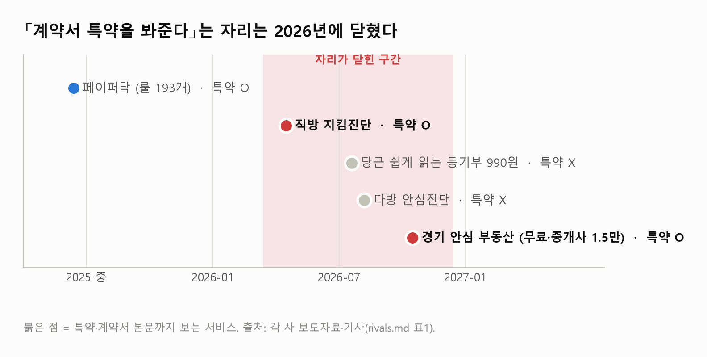
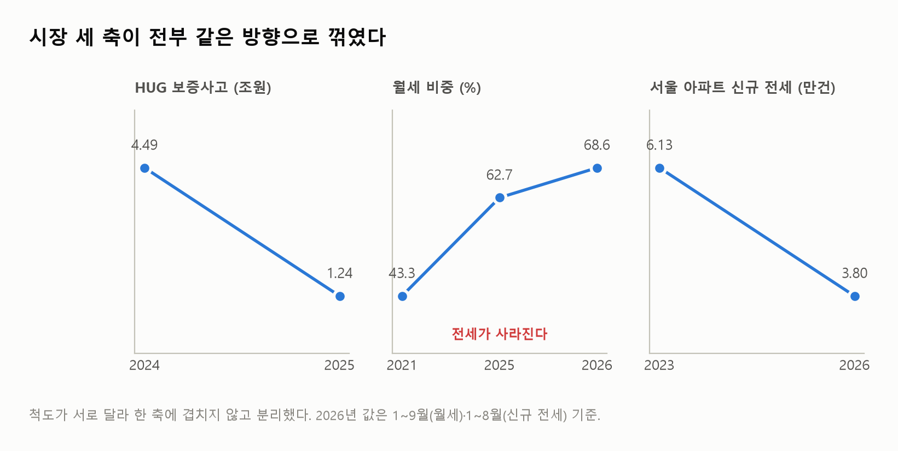
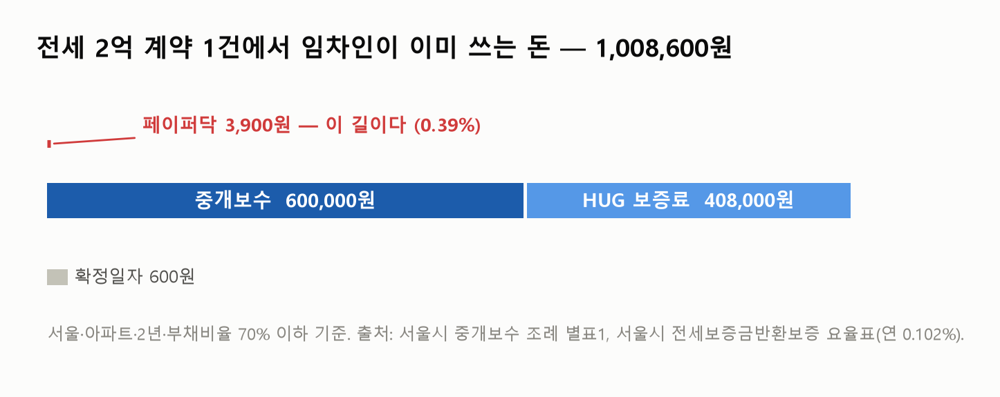
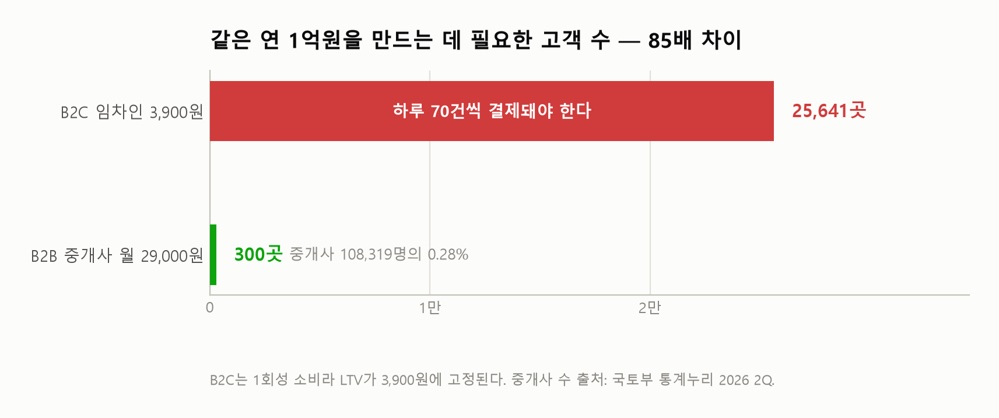

쉬운계약 페이퍼닥 · 시장조사

# 자리는 있었다. 2026년에 닫혔다

바깥만 봤다. 자사 트래픽은 한 줄도 쓰지 않았다. 경쟁 지도 · 시장 규모 · 지불 의사 · 수요 채널 — 네 갈래를 따로 조사해 맞춰 붙였다.

<b>작성</b> 2026년 11월 7일

<b>대상</b> 쉬운계약 페이퍼닥 (paperdoc-web.vercel.app) · 주식회사 타이니셀

<b>방식</b> 에이전트 4기 병렬 · 1차 출처 직접 열람 · 모든 수치에 (값·기준시점·출처 URL)

<b>범위</b> 자사 데이터 미사용. 직전 「긴급 점검」이 자사 블로그를 근거로 삼은 것을 교정한다

---

## 0. 한 장 요약

| 질문 | 답 | 근거 |
|---|---|---|
| 시장이 있나 | **있지만 줄고 있다** | 월세 비중 68.6%(2026 1~9월), 서울 아파트 **신규** 전세 -38.0% |
| 위험이 있나 | **줄고 있다** | HUG 보증사고 4.5조(2024) → 1.2조(2025) → 2026 1~4월 **-53.1%** |
| 자리가 비어 있나 | **2026년에 닫혔다** | 직방 「지킴진단」이 **특약**을 한다(2026-04) · 경기도가 **계약서 분석을 무료**로 한다(2026-10) |
| 돈을 낼 사람이 있나 | **임차인은 아니다** | 세이프홈즈 정밀진단도 **우리은행이 비용 부담** |
| 그럼 누가 내나 | **중개사·은행·지자체** | 중개사는 확인·설명 의무 위반 시 **과태료 500만원** |

> **판정 — 단독 B2C 제품으로는 이미 찬 자리다. 3,900원짜리 임차인 과금은 버린다.**
> 남은 자리는 룰셋을 남의 화면에 공급하는 **B2B2C 한 겹**이고, 그 창도 좁아지는 중이다.
## 1. 누가 이미 하고 있나

**「계약서 조항·특약을 봐준다」는 2025년까지 비어 있던 자리였다. 2026년에 위아래에서 동시에 닫혔다.**

| 서비스 | 제공자 | 특약·계약서 검토 | 가격 | 출시 |
|---|---|---|---|---|
| **직방 지킴진단** | 직방 | **한다** — 6개 진단 항목에 **특약** 포함, "반드시 포함해야 할 구체적 특약 조건까지 안내" | 미공개(출시 무료권) | 2026-04-17 |
| **경기 안심 부동산** | 과기정통부·경기도 | **한다** — "계약서의 주요 내용을 분석하여 누락·보완 사항을 식별" | **임차인 무료** | 2026-10 시범 |
| 세이프홈즈 AI지킴이 | ㈜테라파이 | 안 한다(명시적 배제) | **49,800원/건** · 우리WON뱅킹 채널 | — |
| 당근 쉽게 읽는 등기부 | 당근마켓 | 안 한다 | **건당 990원** | 2026-07-20 |
| 다방 안심진단 | 다방 | 안 한다 | 미공개 | 2026-08-06 |
| 집지켜 | 플다 | 안 한다 | **무료** (누적 10만 7,004건) | — |
| 서울시 청년 AI 리포트 | 서울시 | 안 한다 | **무료** 1인 2회 | — |
| **안심전세App** | 국토부·HUG | **안 한다** — 상세 페이지 전문에 "계약서" 0회 | 무료 | 50만+ 다운로드 |

**직방 쪽 표현이 중요하다** — "수익화하는 AI 비즈니스 모델의 시작점". 무료 체험이 아니라 **유료화를 전제한 진입**이다. 'AI 변호사 + AI 부동산 전문가 교차검증'도 개발 중이다.

**경기도 쪽이 더 무겁다** — 유통망이 **참여 공인중개사 1만 5천 명**이다. 계약 중 음성인식으로 설명의무 점검, 계약 후 등기 24시간 모니터링까지 묶여 있다. 이건 B2C가 아니라 **중개사망을 쥔 B2B2C**이고, 페이퍼닥이 가려던 경로와 같다.

> **반대 증거도 하나 있다.** 안심전세App은 다운로드 34만 건 중 핵심 기능(임대인 정보 조회) 실사용이 **9,916건, 3%**였다(2023.2~10, 국토부→홍기원 의원실). **공공앱이 깔린다고 쓰이는 건 아니다.** 경기도 사업도 같은 운명일 수 있다 — 다만 이건 희망이지 근거가 아니다.

**유료 B2C 단독으로 페이퍼닥의 193개 룰과 정면으로 겹치는 서비스는 못 찾았다.** 즉 깊이는 아직 페이퍼닥이 앞선다. 문제는 그 깊이를 보여줄 화면이 없다는 것이다.

---

## 2. 시장은 커지나 작아지나

**세 축이 전부 같은 방향으로 꺾였다.**

| 축 | 2023~2024 | 최신 | 방향 |
|---|---|---|---|
| **위험** HUG 보증사고 | 4조 4,896억 (2024) | 1조 2,446억 (2025) → 2026 1~4월 **전년비 -53.1%** | ↓ |
| **전세 비중** 월세 비율 | 43.3% (2021) | **68.6%** (2026 1~9월), 단월 70.0%(8월) | 전세 소멸 |
| **신규 계약** 서울 아파트 전세 | 갱신 27.2% (2023) | 갱신 **50.8%** (2026 1~8월), **신규 -38.0%** | ↓↓ |

**세 번째가 가장 치명적이다.** 페이퍼닥 수요는 **신규 계약에만** 붙는다. 갱신은 계약서를 새로 쓰지 않는다. 전체 전세 거래 감소(-25.7%)보다 **신규 감소(-38.0%)가 1.5배 빠르다.**

**엇갈리는 신호 하나를 분리했다.** HUG 사고는 급감하는데 전세사기 피해자 결정은 월 600~660건으로 유지된다(2026년 7월 609 → 8월 658 → 9월 623). 같은 현상이 아니다 — 피해자 결정은 **2023~2024년 과거 계약의 사후 인정**이고 HUG는 **신규 발생**이다. 뉴스에 보이는 피해 건수는 과거의 그림자다.

**세그먼트가 어긋난다.** 피해는 비아파트(다세대·오피스텔·다가구 68~90%) · 보증금 3억 이하 97.7% · 40세 미만 75.9%에 집중된다 — **전세 중심**이다. 그런데 페이퍼닥 누적 110건 중 **89건이 월세**다. **지금 쓰는 사람과 다치는 사람이 다르다.**

**실측 상한 하나.** "계약서를 걱정해서 실제로 행동한 사람"의 유일한 프록시인 **확정일자 정보제공(열람) 건수**는 7만 7,698(2022) → 12만 4,359(2023) → **22만 749건(2024)**으로 2년 만에 3배가 됐다. 다만 그들이 한 행동은 **무료 공적 서비스**다. 분쟁까지 가는 사람은 연 **983건**(2025, 한국부동산원).

**유일한 순풍** — 전세사기특별법은 2027-05-31까지 연장됐으나 **2025-06-01 이후 최초 계약은 적용 제외**다. 공적 구제가 걷히면 자기방어 수요가 생긴다. 다만 같은 기간 신규 전세가 -38%라 **순풍보다 역풍이 크다.**

---

## 3. 누가 돈을 내나

**임차인은 이미 100만원을 쓴다. 3,900원은 그 0.39%다.**

전세 2억(서울·아파트·2년) 기준 필수 비용 **1,008,600원**:

| 항목 | 금액 | 성격 |
|---|---|---|
| 공인중개사 중개보수 | **600,000원** (2억×0.3%, 서울 조례 별표1) | 법정 상한 |
| HUG 전세보증금반환보증 | 204,000원/년 → 2년 **408,000원** (연 0.102%) | 법정 요율 |
| 확정일자 | 600원 | 법정 |

전세 3억이면 **1,542,600원**. 반면 월세(보증금 1,000만/월 60만)는 중개보수 **28만원**뿐이고 3,900원이 1.39%를 차지한다. — **누적 110건 중 89건이 월세다. 가장 돈을 덜 쓰는 층이 사용자다.**

### 그리고 2024.7.10 개정으로 기능 대부분이 중개사 법정 의무가 됐다

권리관계 · 선순위 근저당 · 선순위 보증금 · 확정일자 부여현황 · 국세지방세 체납 · 최우선변제금 · 전입세대확인서 · 관리비 — **전부 중개사 의무**(공인중개사법 §25①, §25의3, 시행령 §21①). 위반 시 **과태료 최대 500만원**(§51②1호의6)과 손해배상(§30①).

> **임차인은 60만원 주고 이미 산 설명을 3,900원에 다시 사는 구조다.**
> 겹치지 않는 영역은 **계약서 특약조항 불리성 판정** 하나뿐이었다 — 그런데 §1에서 본 대로 **직방이 2026-04에 거기로 들어왔다.**

### 이 카테고리의 실제 구매자는 임차인이 아니다

세이프홈즈 인앱 결제 1,100~17,000원으로 **3,900원은 정상 구간**이다. 그런데 정밀진단은 **우리은행 고객 연 1회 무료**, 간편진단·등기변동알리미는 완전 무료다. **돈은 은행이 낸다.**

### 숫자 판정

| 경로 | 연 1억원 만들려면 | 모수 대비 |
|---|---|---|
| **B2C 3,900원** | 25,641건 결제 = **하루 70건** | 연 거래 235만 건의 1.09% · **현재 누적 110건의 233배** |
| B2C 전환 2.18% 가정 | 118만 명 도달 | 연 거래의 **54%** — 비현실 |
| **B2B 월 29,000원** | **300곳** | 개업 중개사 108,319명(2026 2Q)의 **0.28%** |

1회성 소비라 **LTV가 3,900원에 고정**된다. 가격을 내리면 LTV만 줄고, 올려도 결제 건수 벽은 그대로다.

> **팔아야 할 것은 「임차인의 안심 3,900원」이 아니라 「중개사의 500만원 과태료·손해배상 리스크를 줄이는 확인·설명서 작성 보조」다.**
---

## 4. 계약서를 든 사람은 어디서 묻나

**먼저 조사 자체가 막힌 것을 보고한다. 그리고 그게 발견이다.**

`kin.naver.com/robots.txt` 에 이렇게 적혀 있다:

> `# BOT ACCESS FOR THE PURPOSES OF AI TRAINING AND RETRIEVAL-AUGMENTED GENERATION (RAG) IS STRICTLY PROHIBITED.`
> `User-agent: ClaudeBot` / `Disallow: /`

그래서 표본을 51건에서 멈췄고 질문 상세 페이지는 한 건도 열지 않았다. 네이버 카페(전면 Disallow)·디시·에펨코리아·당근 동네생활도 같은 이유로 조사하지 않았다. 뽐뿌는 403이다.

> **「지식iN 질문을 긁어 답변을 단다」는 유통 전략은 두 겹으로 닫혀 있다.**
> **수집**은 robots의 AI 봇 차단, **게재**는 네이버 운영정책의 자동화 수단 금지.

### 운영정책 원문 — 직전 라운드에서 못 찾았던 것을 찾았다

지식iN 전용 운영원칙 문서는 **존재하지 않는다**(고객센터 공개문서 42건 전수 확인). 적용되는 건 네이버 통합 [게시물 운영정책](https://policy.naver.com/rules/service_group.html)이다.

| 조항 | 내용 | 페이퍼닥에게 |
|---|---|---|
| 영리 목적 | "자신만의 특별한 이익을 추구하고자 네이버 서비스를 이용하는 행위는 **물론 허용되지만**" | 홍보 답변 1건은 **금지가 아니다** |
| 자동화 | "사전 허락 없이 **자동화된 수단**(매크로·봇·스크래퍼 등)을 이용하여 게재한 게시물" 제한 | **봇 게재 금지** |
| 도배 | "홍보·광고·판매 목적으로 **동일 또는 유사한 내용**의 게시물을 **지속 반복** 게재" 제한 | **템플릿 복붙 금지** |

**외부 링크 금지 조항은 문서 전체에 없다.** 즉 사람이 매건 다르게 쓰면 가능하다 — 그런데 그러면 **유통량이 안 나온다.** 이게 핵심이다.

### 공식 창구 3종은 전부 막혀 있다

| 창구 | 요건 | 판정 |
|---|---|---|
| 전문가 답변 | "전문 자격증을 갖추고 협회에 소속" | **불가** |
| 지식파트너 | "해당 분야의 **대표적인** 기업·기관·단체" | 사용자 0으로 대표성 입증 **불가** |
| 엑스퍼트 | — | 네이버가 AI 답변 '지식이'를 **2026-05-24 종료**(누적 100만 건, 채택률 33%)하고 **유자격 전문가 답변 강화**로 방향을 틀었다 — 룰 기반 자동 진단에 **정면 역풍** |

### 누가 답하고 있나 (표본 34건, 닉네임 표기 기준)

일반계정 32% · **변호사 18%** · 브랜딩 닉네임 15% · 미표시 9% · **연락처 박은 영업 닉네임 9%** · 세무사 9% · 중개법인 6% · 법무사 3%. 유자격 표기 합계 **35%**.

> 답변 **본문**이 아니라 **답변자 이름 칸**이 광고 지면으로 쓰인다. (`문의 010 ****`, `무료상담 카톡 ****` 형태)

### 사람들이 쓰는 말이 제품 이름과 다르다

제목 51건 중 **"계약서" 1회, "검토" 0회.** 반면 전세 12 · 대출 7 · 등기 6 · "봐주세요" 5.

> **사용자는 「상황」으로 묻지 「문서 작업」으로 묻지 않는다.**
> 그리고 질문은 계약 **전**보다 **틀어진 후**가 많다 — 전세사기·임차권등기·내용증명·최우선변제권·집주인 파산.
> 페이퍼닥은 **계약 전** 제품이다. 질문이 쌓이는 시점과 제품이 쓸모 있는 시점이 어긋난다.

*("봐주세요"로 검색하면 1페이지 10건 중 7건이 사주·보험 설계다. 부동산 전용 표현이 아니다.)*

*※ 네이버 검색 결과 건수는 지표로 쓸 수 없다 — "임대차계약서 검토"와 "월세 계약서 확인"이 똑같이 411,012로 나온다(토큰 OR 집계).*

---

## 5. 판정

**네 갈래가 서로 모르는 채 조사했는데 같은 결론에 도달했다.**

| 조사 | 각자의 결론 | 공통 방향 |
|---|---|---|
| 경쟁 지도 | "계약 직전 임차인 화면을 못 쥐면 193개 룰의 깊이는 안 팔린다" | → 남의 화면에 올라타라 |
| 시장 규모 | 신규 전세 -38%, 피해 -53%. 임차인 모수가 줄고 있다 | → 임차인 말고 |
| 지불 의사 | B2C 하루 70건 vs **B2B 300곳**. 중개사엔 과태료 500만원이라는 법정 지불 이유가 있다 | → 중개사에게 |
| 수요 채널 | "질문에 답하는 쪽"이 아니라 **"질문에 답하는 변호사·중개사가 쓰는 도구"** | → 중개사·변호사에게 |

> ### B2C 3,900원 임차인 과금은 버린다.
> ### 남은 것은 「중개사의 확인·설명 의무를 대신 체크해 주는 도구」 하나다.

**그 자리도 좁다, 그리고 시한이 있다.** 경기도가 중개사 1만 5천 명을 무료로 덮고 있다 — 전국 개업 중개사 108,319명의 **14%**다. 남은 86%는 아직 비어 있지만, 경기도가 2027년 정식 전환하고 직방이 자체 개발을 끝내면 닫힌다. **창은 길게 잡아 12개월이다.**

### 이번 주에 바뀌는 것

직전 「긴급 점검」의 집행안을 **대상만 바꿔** 그대로 쓴다. 분량도 시간도 같다.

| | 직전 라운드 | 이번 라운드 | 왜 |
|---|---|---|---|
| 대표 문서 요청 1통 (2h) | 소스·배포권·분사·무료베타 | **그대로 + 「B2B 피벗을 해도 되는가」 추가** | 피벗이면 소스가 더 급해진다 |
| 손 검증 12건 (13h) | **임차인** 12명 | **중개사 5명 + 임차인 5명** | 지불 의사가 임차인 쪽에 없다 |
| 지식iN 답변 | 보류 | **폐기** | robots 차단 + 자동화 금지 + 공식창구 3종 전부 자격 미달 |
| 결제 개시 | 보류 | **보류 유지** | 변호사법 §109 방어 + 서버 잔액 없음(전자상거래법) |

**중개사 5명에게 보여줄 것은 분석 리포트가 아니라 「확인·설명서에 빠진 항목 목록」이다.** 그들이 사는 것은 안심이 아니라 과태료 회피다.

**임차인 5명은 반드시 전세·신규 계약으로 잡아라.** 누적 110건 중 89건이 월세인데, 피해는 전세·비아파트·40세 미만에 몰린다. 지금 쓰는 사람과 다치는 사람이 다르다.

---

## 6. 내가 앞서 틀렸던 것

| 앞선 보고 | 교정 |
|---|---|
| "이번 주 채널은 **네이버 지식iN** 하나" | **폐기.** robots가 AI 봇을 차단하고, 네이버 운영정책이 자동화 게재를 금지하며, 공식 창구 3종은 자격·대표성 요건으로 막혔다. 사람이 매건 손으로 쓰면 규칙상 가능하지만 유통량이 안 나온다 |
| "비중복 영역은 **특약 불리성 판정** 하나" | **그 하나도 찼다.** 직방 지킴진단이 2026-04부터 특약을 포함한다 |
| 블로그 수치로 유통을 진단 | **시장 근거가 아니었다.** 자사 트래픽은 "우리 유통이 실패했다"의 증거일 뿐이다. 이번 라운드는 자사 데이터를 한 줄도 쓰지 않았다 |

**하나는 유리한 쪽으로 틀렸다** — 2026-03 대법원이 **"법률문서 자동 작성 = 기술적 도구 제공"**(법률사무 대리 아님)으로 판단했다. 내가 앞서 보고한 변호사법 §109 리스크는 그만큼 낮아진다. **다만 이건 기사 경유 인용이고 판결 원문을 못 읽었다.** 사업계획서에 쓰기 전에 변호사 확인이 필요하다.

---

## 7. 못 찾은 것

- **국토부 공식 연간 전월세 거래량 누계** — molit·R-ONE·KOSIS 통계표 접근 실패. 본문 235만 건은 월간 수치 **연환산 추정(신뢰도 70%)**
- **확정일자 열람 2025·2026 수치** — 등기정보광장이 로그인 요구. 2024년 22만 749건이 최신값
- **직방 지킴진단·다방 안심진단 가격** — 미공개
- **안심전세앱 2024~2026 실제 이용 건수**, 2026-09 개편의 실제 시행 여부 — 전부 "예정/추진" 보도뿐
- **유료 전환율** 한국 B2C 공개 수치 — 없음. 본문의 2.18% 가정은 **근거 없는 수치**이며 깔때기 최종 모수 신뢰도는 30%
- **중개사 대상 SaaS 공개 요금표** — 한방·다방프로 무료, 부동산플래닛 비공개. B2B 월 29,000원은 **가격 가설이지 시장가가 아니다**
- 로톡 정가(정책상 비공개), HF·SGI 보증료율, 법무사 공식 보수표
- **"지식파트너 330여곳"** — 커뮤니티 재인용만 존재. **인용하지 말 것**
- 지식iN 답변 본문·답변자 프로필 — robots 준수로 미수집. 답변자 분류는 **닉네임 표기 기준 34건 표본**이며 일반화 불가

*law.go.kr은 WebFetch·curl·OPEN API가 전부 차단되어 법 조문은 법제처 유권해석 페이지와 조문 미러로 교차 확인했다.*
