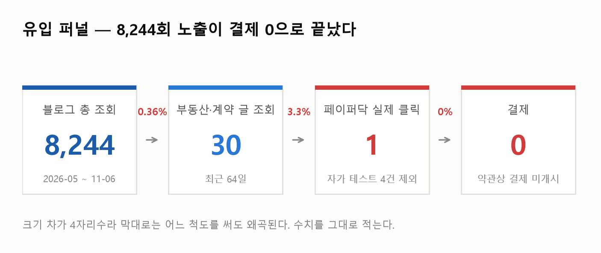
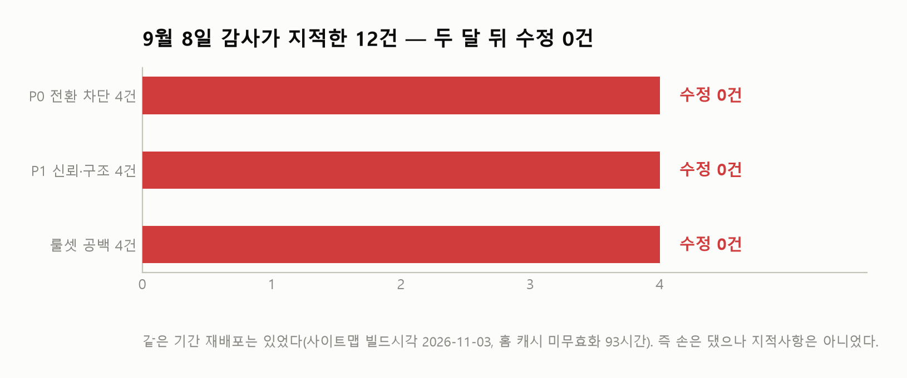
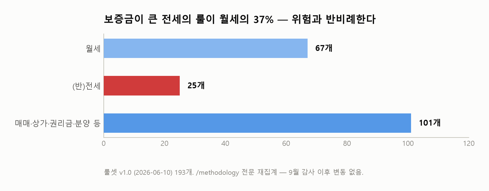
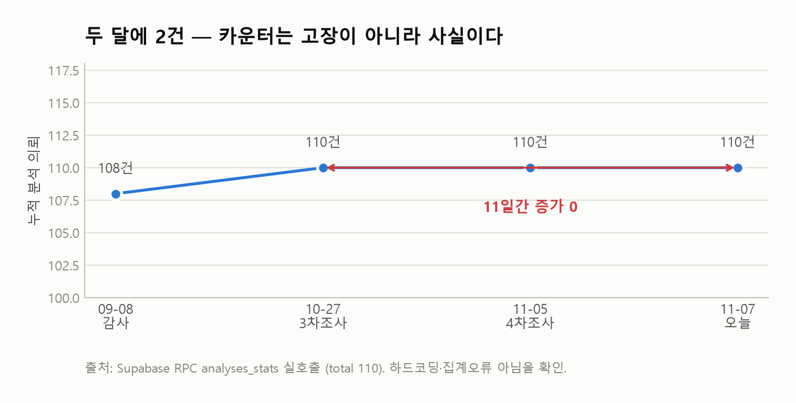
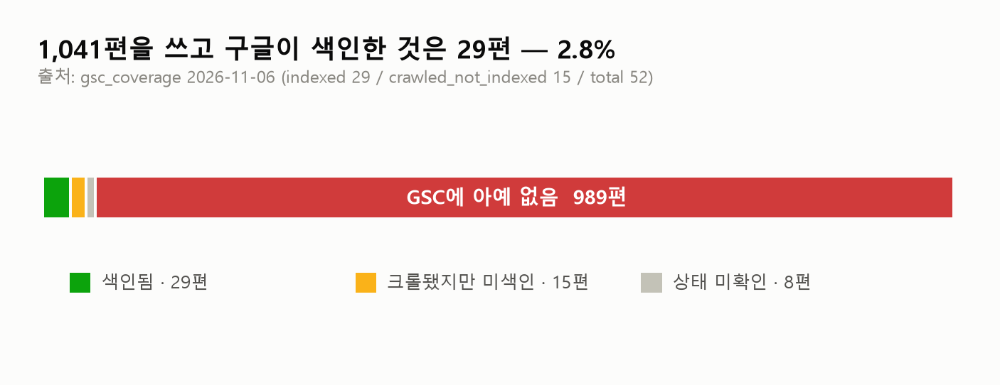
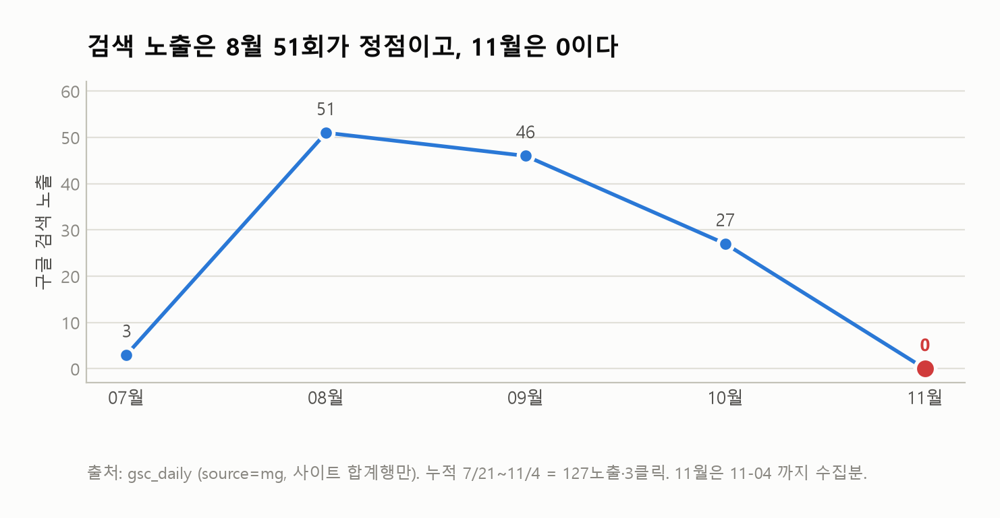
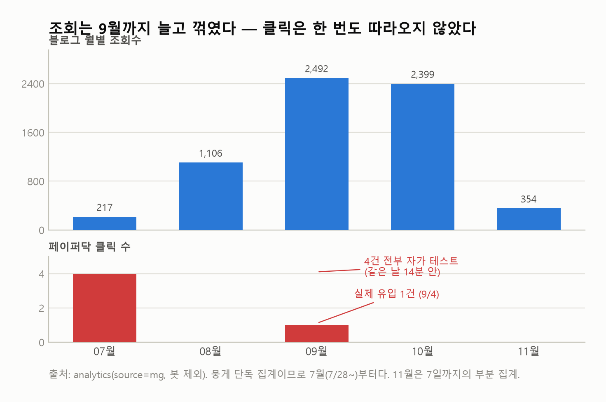

<div class="kicker">쉬운계약 페이퍼닥 · 긴급 점검</div>

# 멈춘 것은 제품이고,<br>멈추지 않은 것은 배포권이다

<p class="lead">9월 8일 감사 이후 두 달. 지적 12건 중 고쳐진 것은 0건이고, 그 사이 배포는 돌았다.<br>그리고 소스는 의뢰인 손에 없다.</p>

<div class="meta">
<div><b>작성</b> 2026년 11월 7일 · <b>2판</b>(같은 날 블로그 수치 재실측 후 정정 — §3 참조)</div>
<div><b>대상</b> 쉬운계약 페이퍼닥 (paperdoc-web.vercel.app) · 주식회사 타이니셀</div>
<div><b>방식</b> 에이전트 7기 병렬 — 조사 5기 + 반대 입장 토의 2기</div>
<div><b>근거</b> 라이브 사이트 curl 실측 · Supabase 직접 집계 · JS 번들 역분석 · 법령 조문과 판례 원문</div>
</div>

---

## 0. 세 문장

1. **제품은 멈춰 있고, 그 이유는 의욕이 아니라 권한일 가능성이 높다.** 9월 감사가 지적한 12건이 두 달 뒤에도 그대로인데 11월 3~5일에 재배포는 돌았다. 소스 코드는 이 PC 어디에도, 접근 가능한 GitHub 222개 저장소 어디에도 없다. **의뢰인이 못 미는 버튼을 지난주에 누군가 눌렀다.**

2. **「아무도 안 쓴다」는 아직 측정된 적이 없다.** 누적 110건, 두 달에 +2건, 실제 유입 클릭 1건은 사실이다. 그러나 최근 64일간 **타깃 독자에게 노출된 횟수가 9회**다. 9회에서 클릭 0은 통계적으로 아무 의미가 없다 — CTR이 20%였어도 0이 나올 확률이 13%다. **블로그 331편을 썼지만 구글 검색 노출은 최근 넉 달 누적 127회이고 부동산 글은 0회였다.** 닿은 적이 없었다.

3. **그래서 이번 주에 할 일은 두 가지이고, 둘은 같이 간다.** 대표에게 보낼 문서 요청 1통(2시간)과, 아는 사람 12명의 계약서를 손으로 점검하는 검증(13시간). **그리고 결제는 열지 않는다** — 변호사법 제109조의 구성요건은 "이익을 받거나 받을 것을 약속하고"이고, 결제를 닫아 둔 것이 지금 공짜로 가진 유일한 방어다.

> **이번 보고서에서 앞선 권고 두 개를 뒤집는다.**
> **①** 토스 미니앱 반려는 「반나절 작업」이 아니다 — 앱인토스 정책상 **부동산 카테고리 한시적 출시 불가**다.
> **②** 결제 개시는 병목이 아니다 — **그게 형사 구성요건을 켜는 스위치다.** 순서를 뒤로 미룬다.
---

## 1. 먼저 이 숫자부터



2026년 5월부터 11월 6일까지 자사 블로그에 **8,244회**의 조회가 들어왔다. 그중 페이퍼닥 링크를 누른 사람은 **5명**이고, 그 5건의 메타데이터를 전수로 열어 보니 **4건은 2026-07-20 같은 날 14분 안에 찍힌 자가 테스트**였다(`__test: redirect-verify`, `ref: direct`, `referrer_site: lifeflow`). 남는 실제 유입은 **1건**, 2026-09-04에 「인디게임 수익 현실」 글에서 들어온 것이다.

**그 뒤로 오늘까지 64일간 클릭 0건이다.**

| 지표 | 값 | 출처 |
|---|---|---|
| 누적 분석 의뢰 | **110건** (9/8 감사 시점 108건 → 두 달에 +2) | Supabase RPC `analyses_stats` 실호출 |
| 누적 진단(이 집, 괜찮을까?) | 31건 | RPC `diagnoses_stats` 실호출 |
| 분석 110건의 유형 분포 | 월세 89 / 전세 6 / 권리금 3 / 매매 3 / 상가 1 / 분양 1 / 단독 7 | 같은 RPC |
| 페이퍼닥 실제 유입 클릭 | **1건** (2026-09-04가 마지막) | `analytics` 테이블 전수 조회 |
| 매출 | **0원** | 결제 미개시 |

월세에 89건이 몰린 분포는 실사용자의 분포라기보다 **개발 중 테스트의 흔적**으로 보는 편이 자연스럽다(추정, 신뢰도 85%).

---

## 2. 제품은 9월 8일 이후 멈춰 있다



2026-09-08 전방위 감사가 지적한 항목을 오늘 라이브에서 하나씩 다시 확인했다. **12건 중 수정이 확인된 것은 0건이다.** (2건은 클라이언트 렌더라 curl로 판정하지 못했다 — 고쳐졌을 가능성을 배제하지는 않는다.)

| # | 감사 지적 | 오늘 판정 | 근거 (2026-11-07 curl 실측) |
|---|---|---|---|
| P0-1 | 무료 샘플 리포트를 첫 화면에 | **미수정** | 전 페이지 `sample`·`샘플`·`데모`·`무료 체험` **0건**, `/sample` 경로 없음 |
| P0-2 | 이미지 히어로 → 텍스트 히어로 + h1 | **미수정** | 홈 `<h1>` **0개**(h2 1개, h3 0개). `/hero.png` 비트맵 그대로 |
| P0-3 | 카카오 로그인 추가 | **미수정** | `kakao`·`카카오` **0건**. `signInWithOAuth({provider:"google"})` 4곳 + 이메일 OTP |
| P0-4 | 390px 이용권 박스 깨짐 | **판정 불가**(미수정 추정 60%) | CSS에 `sm:flex-row` 계열 분기 없음. 렌더 실측은 못 함 |
| P1-5 | `/methodology`를 홈으로 승격 | **미수정** | 홈에서 `/methodology` 링크는 푸터 1곳뿐 |
| P1-6 | 신뢰 블록 재배열 | **확인 못 함** | 클라이언트 렌더라 curl로 순서 판정 불가 |
| P1-7a | FAQ 「룰셋은 검수를 거쳐 보완됩니다」 정리 | **미수정** | `/faq`에 "룰셋은 정식 서비스 전 변호사·법무사·공인중개사 검수를 거쳐 보완됩니다." 그대로 |
| P1-7b | 전화·채널톡 창구 추가 | **미수정** | 푸터 `tinycell2019@gmail.com` 단독. `channel.io`·`채널톡` 0건, 전화번호 0건 |
| P1-8 | 투어 「건너뛰기」 영구 저장 | **미수정**(부분 구현) | 키 `pd_tutorial_snoozed_until` = `Date.now()+864e5` → **24시간 스누즈**일 뿐 |
| 룰셋 갭 1 | 주임법 §3조의7 (임대인 정보 제시 의무) | **0건** | `/methodology` 전문 269KB grep |
| 룰셋 갭 2 | 국세·지방세 체납(당해세 우선변제) | **0건** | 같은 문서. 「국세징수법」은 등기부 압류 룰에만 1회 |
| 룰셋 갭 3 | 신탁부동산 **계약서** 룰 | **0건** | `신탁` 5회 전부 등기부 룰 |
| 룰셋 갭 4 | 대리인 계약 시 위임장·인감증명서 | **0건** | `위임장`·`인감`·`대리인` 각 0건 |

룰셋 헤더는 여전히 **`v1.0 · 2026-06-10 기준 · 총 점검 항목 193개`** 다. 5개월째 개정이 없다.



배분도 그대로다. **보증금이 훨씬 큰 전세의 룰이 월세의 37%**다 — 위험과 반비례한다. 그리고 실제 사용 분포는 그 반대로 월세 89건 / 전세 6건이라, 룰이 적은 쪽은 쓰이지도 않았다.

### 그런데 배포는 있었다

| 신호 | 값 |
|---|---|
| 정적 자산 `Last-Modified` | **2026-11-05 01:16 GMT** (KST 10:16) — 현 배포가 참조하는 해시 청크 |
| `sitemap.xml` 전 28개 URL `lastmod` | 2026-11-03T07:27:10.782Z (28개 전부 동일 = 빌드 시각) |
| 홈 HTML 캐시 생성(Age 역산) | ≈ 2026-11-03 17:36 GMT |

세 신호가 서로 1.5일 어긋나 시점을 한 점으로 못 박지는 못했지만, **2026-11-03 ~ 11-05 사이에 재배포가 있었던 것은 확실하다**(추정 75%). `/version`·`/api/health` 같은 엔드포인트가 없고 과거 아카이브 스냅샷도 0건이라 그 이상 좁히지 못했다.

> **즉 손은 댔는데, 지적받은 것은 하나도 안 고쳤다.** 의존성·환경변수 수준의 재빌드였을 가능성이 높다(추정 60%).
>
> 그리고 더 중요한 질문이 남는다 — **소스가 의뢰인 손에 없는데, 그 배포는 누가 했는가.**



카운터가 고장났을 가능성은 배제됐다. 홈 HTML의 값은 `—`(대시)이고, 클라이언트가 Supabase RPC `analyses_stats`를 호출해 실시간 값을 받아온다. 직접 호출해 보니 `{"total": 110}`이 돌아왔다. **하드코딩도, 집계 오류도 아니다. 숫자는 정직하다.**

---

## 3. 유통은 닿은 적이 없다

여기가 이번 조사에서 해석이 가장 크게 바뀐 지점이다.

> **정정 (2026-11-07 재실측).** 초판의 이 절 수치 네 개가 틀렸다. 직접 쿼리를 다시 돌려 바로잡는다.
>
> | 항목 | 초판 | 실측 | 원인 |
> |---|---|---|---|
> | 블로그 글 수 | 1,041편 | **331편** | GA4 `page_source` 차원의 키 개수(글 × 유입소스 조합, 현재 1,106)를 글 수로 오독 |
> | 색인률 | 2.8% | **8.8%** (추적분 52편 기준 55.8%) | 위 분모 오류 |
> | 구글 노출 | 8월 170 / 9월 114 / 10월 54 | **8월 51 / 9월 46 / 10월 27** | 사이트 합계행(`_TOTAL_`)과 페이지별 행을 함께 더한 이중계상 |
> | 부동산 글 조회 | 64일 30뷰 | **64일 9뷰** (전 기간 20뷰) | 집계 차원 혼용 |
>
> 결론의 방향은 바뀌지 않는다. 노출·조회는 오히려 **초판보다 적고**, 그래서 「측정된 적이 없다」는 판정은 더 강해진다. 다만 색인률 정정으로 **진단의 기전이 바뀐다** — 「색인이 거의 안 됐다」가 아니라 **「색인은 되는데 순위가 안 나와 노출이 월 수십 회에 그친다」**가 맞다.



자사 블로그 `mungge.com`에 글 **331편**이 올라가 있다(고정페이지 48개는 별도. wp-json `X-WP-Total` 및 사이트맵 `<loc>` 331개, 2026-11-07 실측). 그중 **색인 상태가 확인된 것은 52편**이고, 색인 29편 · 크롤됐지만 미색인 15편 · 상태 미확인 8편이다. 나머지 **279편은 색인 상태가 한 번도 확인된 적이 없다.**



검색 노출은 **8월 51회가 정점**이고 9월 46 → 10월 27 → 11월 **0**이다. 7/21~11/4 누적으로 **127노출·3클릭**이다. 같은 계정의 다른 사이트 playcast는 같은 기간 **726노출·19클릭**이었으니, 수집 파이프라인 문제가 아니라 mungge 쪽의 문제다.



온사이트 조회는 늘다가 꺾였다. 뭉게 단독 집계로 7월 217(7/28~) → 8월 1,106 → **9월 2,492(정점)** → 10월 2,399 → 11월 354다. 그런데 클릭은 한 번도 따라오지 않았다.

> 초판은 여기에 「5월 183 → 10월 2,535, 14배」라고 썼다. 5·6월 수치는 **뭉게가 아니라 그 앞에 돌던 다른 블로그(`blog`)의 것**이었다. 두 사이트를 한 줄로 이어 붙인 수치였으므로 버린다.

**왜 클릭이 안 늘었는지가 핵심이다.** 최근 64일간 조회가 일어난 글 상위권은 이렇다:

| 글 | 조회 |
|---|---|
| 홈 | 289 |
| 2026년 클로드 만 18세 이상 제한 총정리 | 61 |
| 클로드코드 사용량 한도 2026 | 40 |
| 2026 전기기사 자격증 가이드 | 39 |
| 2026 여행카드 비교 | 34 |
| 인디게임 수익 현실 2026 | 28 |
| 신한카드 2026 혜택·연회비 | 25 |

**부동산·임대차를 다룬 글은 전부 합쳐 최근 64일 9뷰다**(전 기간 20뷰). 세부로는 전세보증보험 7, 전세·월세 체크리스트 7, 국민주택연금 3, 주택청약 2 — 그리고 제품과 가장 가까운 **「부동산 계약서 검토 체크리스트」는 전 기간 통틀어 1뷰**다.

그리고 그 글들의 **구글 검색 노출은 0이다.** `page` 에 `contract|jeonse|wolse|lease|real-estate|housing|deposit|guarantee` 가 들어간 행을 2026-09-01 이후로 조회하면 **빈 결과**가 나온다.

> **그래서 "배너가 실패했다"도 "제품이 매력 없다"도 이 데이터로는 말할 수 없다.**
> 2개월 동안 타깃 독자 **9명**에게 보였고 그중 0명이 눌렀다. 9명에서 0은 통계적으로 아무것도 아니다 — 참 CTR이 **20%**였어도 0이 나올 확률이 13%다.
> 331편을 쓰고 검색 노출이 넉 달 누적 127회인 채널이 부동산 수요자에게 닿을 길은 애초에 없었다.
>
> 지금까지 다섯 번의 시도(뭉게 331편·네이버 블로그 63편·배너 3채널·자체 SEO 28URL)가 전부 **"내 도메인을 띄우는"** 방식이었다. 남의 질문 페이지 위에 얹히는 방식은 한 번도 집행된 적이 없다.

## 4. 결제가 안 열린 이유 — 앞선 보고를 정정한다

**정정.** 직전 세션에서 나는 앱인토스 반려가 "아이콘 규격과 설명 미제출뿐이라 반나절 작업"이라고 보고했다. **그 판단은 틀렸다.** 반려 메일에 적힌 사유는 그 두 가지가 맞지만, 앱인토스 공식 정책을 읽어 보니 그보다 앞선 벽이 있다.

| 벽 | 내용 | 출처 |
|---|---|---|
| **카테고리 차단** | "부동산 카테고리: 매물 검색, 시세 조회, 청약/분양, 중개, 대출 비교, 전세보증금/보험, 경매/공매, **임대차 관리**, 부동산 투자, **등기/법무**, 세금 계산 … 수수료 모델 검토를 위해 지금은 입점이 한시적으로 제한" | developers-apps-in-toss.toss.im `/intro/guide.md` §9 |
| **SSR 금지** | "서버 사이드 렌더링(SSR)은 사용할 수 없어요(CSR/SSG만)" — 페이퍼닥은 Next.js 프리렌더 | `/checklist/app-nongame.md` |
| **자사 도메인·자사 로그인 금지** | 토스 도메인 외부 렌더링 불가, 토스 로그인 외 방식 제공 불가 — 페이퍼닥은 구글 로그인 | 같은 문서 |
| **타 PG 금지** | 디지털 상품은 인앱결제만, 수수료 앱마켓 15% + 토스 5% | `/guide/monetization/in-app-payment.md` |

임대차 계약서 점검이 저 "임대차 관리 / 등기·법무"에 해당할 가능성이 높다(추정 70% — 「계약서 검토」가 명시 열거되지는 않았다). **아이콘 재제출은 이 목록에서 가장 작은 조각이다.**

반면 **웹에서 결제를 여는 길은 생각보다 가깝다.**

- 약관에서 고칠 곳은 **딱 2군데**다 — 제3조와 제3조의2⑤의 "앱(구글 플레이·앱스토어) 출시 후" 문구. 나머지 조항(유효기간·청약철회·환불·분쟁)은 이미 전자상거래법 기준으로 완비돼 있어 결제를 막지 않는다.
- 타이니셀은 **사업자등록(532-88-01426)과 통신판매업 신고번호(2024-서울구로-1745)를 이미 보유**한다. 신규 신고가 필요 없다.
- 토스페이먼츠 카드사 심사는 **10~14영업일**.

| | A. 토스 미니앱 | B. 약관 수정 + 웹 PG | C. 구글플레이 TWA |
|---|---|---|---|
| 막는 것 | 부동산 카테고리 제한, SSR 금지, 자사 로그인 금지, 재개발 필요 | **소스·배포 권한, 대표 서명** | 12명·14일 비공개 테스트, 계정 주체 결정 |
| 소요 | 재개발 + 검수 3~7영업일 + 승인 불확정 | 약관 2곳 + 심사 10~14영업일 + 연동 | 최소 3주 이상(추정) |
| 수수료 | 15% + 5% | 못 찾음 | 10%(+5%) 예정 |
| 판정 | **사실상 막힘** | **가장 가까움** | 차선 |

---

## 5. 코드가 약관과 다르게 동작한다

이번 조사에서 가장 뜻밖이었던 발견이다. 라이브 JS 번들을 내려받아 난독화를 풀었다.

```js
// _next/static/chunks/app/layout-5fa01c9e6e17ee8a.js (및 123-6efa373e.js, 동일 훅 2벌)
function useCredits() {
  const { user }  = useAuth();
  const isAdmin   = isAdminEmail(user?.email);
  const unlimited = !!user;                               // ← 로그인했으면 무조건 true
  const [balance, setBalance] = useState(0);
  useEffect(() => {                                        // 잔액은 localStorage 에서만 읽는다
    const v = parseInt(localStorage.getItem("pd_credits"), 10);
    setBalance(Number.isFinite(v) && v > 0 ? v : 0);
  }, []);
  return { balance, isAdmin, unlimited, hasAccess: unlimited };   // ← balance 를 보지 않는다
}
```

**`hasAccess = !!user`.** 구글 로그인만 하면 아무나 계약서 분석을 무제한으로 돌릴 수 있다. 관계자 명단 확인도, 크레딧 차감도 접근 판정에 들어가지 않는다. 같은 구조가 진단 기능(`pd_diag_credits`)에도 한 벌 더 있다.

그런데 라이브 약관은 이렇게 공표하고 있다.

> **제3조 (요금)** 계약서 분석은 선불 이용권 기능이며, 무료로는 계약별 셀프 체크리스트를 이용할 수 있습니다. … 이용권 결제는 앱(구글 플레이·앱스토어) 출시 후 제공될 예정이며, **그 전까지 분석은 관계자에게만 제공됩니다.** 구독·자동결제는 없습니다.

세 가지가 따라 나온다.

1. **유통이 막혀 있다는 전제가 틀렸다.** 낯선 사람을 데려와도 로그인만 하면 리포트를 끝까지 본다.
   그리고 이게 진단 전체를 바꾼다 — **이 제품은 17개월 동안 단 한 번도 유료 벽에 막힌 적이 없다.** 누구나 무제한으로 쓸 수 있는 상태에서 110건이다. 그러므로 「결제가 안 열려서 안 쓴 것」도 「관계자 제한 때문」도 **코드 수준에서 성립하지 않는 설명**이다. 남는 원인은 **노출뿐**이고, 타깃 노출은 64일에 9회였다.
2. **결제는 UI 껍데기만 있고 실제로 구현된 적이 없다.** 크레딧이 브라우저 `localStorage`에만 있고 서버 검증이 없다. 가격표는 번들에 박혀 있다 — 분석 1건 **3,900** / 3건 9,200 / 10건 22,600, 진단 1건 2,900 / 3건 6,900 / 10건 16,900.
3. **약관과 제품이 어긋난 채로 운영되고 있다.** 이건 기술 문제가 아니라 책임 문제다.

### 더불어 확인한 것들

- `/terms`·`/privacy`·`/diagnosis` 가 홈과 **동일한 `<title>`·description·`og:url`** 을 낸다. `canonical` 태그는 5개 주요 페이지 전부 없다. 색인되면 홈의 중복으로 취급될 위험이 크다.
- `og:image`가 `/hero.png` **1.3MB**다. 공유 미리보기가 무겁다(추정 50%).
- `robots.txt`는 정상(Allow), `noindex` 없음, sitemap 28개 URL 전부 200. **차단이 아니라 발견 신호가 0인 상태**다.
- `paperdoc.kr`은 미등록(NXDOMAIN 추정), `paperdoc.co.kr`은 **타인의 의학 서비스**가 쓰고 있다. 지금 주소는 `*.vercel.app` 서브도메인이다.
- 404/500·깨진 번들 없음. `favicon.ico`만 404.
- `/notices`의 최신 공지가 아직 **「[그랜드 오픈] 쉬운계약 페이퍼닥, 오늘부터 시작합니다」**와 **「페이퍼닥 오픈 기념! 등기사항전부증명서 무료 분석 이벤트」**다. 작성 2026-05-14 / 수정 2026-07-07. **6개월째 "방금 오픈했습니다" 상태로 서 있다.**

### 다만 무료 영역은 로그인 없이 열린다 (확인함)

`/docs/*` 셀프 체크리스트 11종과 `/special-terms` 추천 특약 문안은 **비로그인 curl로 본문이 전부 렌더된다.** 서버 프리렌더이고 로그인 벽이 없다. `/special-terms`에는 복사 가능한 특약 문안이 들어 있다 — 링크 하나로 바로 쓸 수 있는, 지금 상태에서 유일하게 **남에게 건넬 수 있는 자산**이다.

---

## 6. 소스가 없다

조사 내내 작업 목록이 같은 벽에서 멈췄다.

- 이 PC **전 드라이브(C/D/E/F)** 에서 `analyses_stats`·`쉬운계약` 문자열 검색 → **0건**
- GitHub `YDINP`(개인) **44개 repo**, `TinycellCorp`(회사) **178개 repo** 전수 조회 → paperdoc 관련 repo **0건**
- `.vercel` 프로젝트 링크 디렉터리 전수 조회 → paperdoc **없음**
- 그런데 **2026-11-03~05에 재배포가 일어났다**

조사팀이 낸 「당장 할 것」 중 **메타태그 수정, 카운터 노출 조정, 약관 문구 수정, P0 4건, 룰셋 갭 4건**이 전부 이 벽에 막혀 있다. 한 줄도 고칠 수 없다.

정리하면 이렇다. **의뢰인은 분사해서 창업하겠다는 제품의 소스를 가지고 있지 않고, 배포 권한도 없으며, 지금 이 순간에도 다른 누군가가 그 제품을 배포하고 있다.** 그리고 분사 합의는 구두뿐이고, 약관 제6조의2 ①은 룰셋·분석로직·디자인·상표 일체의 지식재산권이 **회사에 귀속**한다고 대외에 공표돼 있다.

---

## 7. 법률 — 가지고 나갈 수 있는가

법령 원문과 판례를 1차 출처로 다시 확인했다. **결론부터 쓰면, 제품은 타이니셀 것이고 근로계약서를 찾아봐도 거의 뒤집히지 않는다.**

### 7-1. 저작권법 제9조는 「특약이 없으면 법인 귀속」이 기본값이다

> **저작권법 제9조** "법인등의 명의로 공표되는 업무상저작물의 저작자는 **계약 또는 근무규칙 등에 다른 정함이 없는 때에는 그 법인등이 된다.** 다만, **컴퓨터프로그램저작물**의 경우 공표될 것을 요하지 아니한다."

| 요건 | 페이퍼닥 | 판정 |
|---|---|---|
| ① 법인의 기획 | 1인 운영이라 사실상 의뢰인 단독 기획일 수 있으나, 법인 명의 운영·사업자등록·통신판매업 신고가 전부 타이니셀 | 충족 쪽 **유력 70%** |
| ② 업무상 작성 | 재직자. 근무시간 외·개인 장비였다면 다툴 여지 — **유일한 반격 지점**이나 입증이 어렵다 | **불확실** |
| ③ 법인 명의 공표 | 푸터 `© 2026 TinyCell Corporation`, 약관·처리방침 운영주체 「주식회사 타이니셀」 — 라이브 전 페이지 | **확정** |
| ③의 예외 | **프로그램저작물은 공표 요건 불요** → 소스코드는 ①②만으로 법인 귀속 | **확정** |

| 대상 | 귀속 | 라벨 |
|---|---|---|
| 소스코드 | 타이니셀 | 유력 80% |
| 화면·리포트 서식·약관·처리방침·`/methodology` | 타이니셀 | 유력 85% |
| 상표 「페이퍼닥」·「쉬운계약」 | **등록 여부 미확인** | 확인 필요 |

**제9조는 양도가 아니라 원시취득이다.** 저작재산권은 물론 **저작인격권(성명표시권)도 처음부터 갖지 못한다.** "내가 만들었으니 내 이름은 남는다"가 성립하지 않는다.

> **9월 감사보고서 교정 ①.** 감사는 「근로계약서 한 장이 이후 전부를 결정한다」고 봤다. **방향이 반대다.** 특약이 없을 때 이미 법인 귀속이고, 특약은 통상 회사에 유리한 방향으로 쓰인다. 개인 귀속 특약이 있을 확률은 사실상 0이다. 근로계약서 확인의 실익은 저작권이 아니라 **겸업·경업 금지 조항**뿐이고, 그건 합의서 한 줄로 덮인다. (덧붙여 이 PC 전 드라이브에 근로계약서 파일 0건이다.)

### 7-2. 룰셋 193항목 — 세 층으로 나뉘고 층마다 답이 다르다

| 층 | 결론 |
|---|---|
| **소재**(주임법·상임법 조문, 국토부 표준계약서 서식) | **누구의 것도 아니다.** 저작권법 제7조 1·2·4호로 보호 대상이 아니다. **확정** |
| **편집저작물로서의 창작성** | **불확실.** 대법 2001다9359(「법조수첩」 — 공개 법령·공공정보를 실무용으로 정리, **창작성 부인**)와 구조가 같다. 반면 193개만 취사선택한 점, 가중치·확인률 산정, 6종 분기는 창작성 쪽 근거. **어느 쪽도 50%를 넘겨 말할 수 없다** |
| **데이터베이스제작자의 권리 (제93조)** | **이게 실제 차단 요인이다.** 창작성을 따지지 않는다. 「상당한 투자를 한 자」 = 타이니셀. 존속기간은 **제작 완료 다음 해부터 5년**(제95조①) |

**실행 결론**

| 경로 | 결과 | 라벨 |
|---|---|---|
| 룰셋 DB를 **통째로 복사**해 신설법인에서 사용 | **제93조① 침해 소지** | 유력 80% |
| 근거 **법령·표준계약서를 참조해 룰셋을 다시 구성** | 제7조 + 제93조④(소재 자체에는 미치지 않음)로 **막히지 않는다** | 유력 70% — **변호사 확인 필요** |
| 193개라는 **항목 수·구성·순서를 그대로 재현** | 제93조②의 "반복적·체계적" 평가에 걸릴 여지 | 불확실 |

> **즉 클린룸 재구축 경로는 열려 있다.** 가져갈 것은 근거 법령 목록이고, 항목 구성은 다시 설계해야 한다.

### 7-3. 약관 제6조의2 — 효력은 없고, 증거로서 무겁다

약관은 **회사와 이용자** 사이의 문서다. 의뢰인은 이 약관의 "이용자"가 아니라 회사 측 사람이므로, **제6조의2가 회사-의뢰인 간 권리를 바꾸지는 않는다(확정).**

**그런데 위험은 효력이 아니라 증거에 있다.** 제9조 요건 중 가장 다투기 쉬운 ①기획과 ③법인 명의 공표를, 이 약관 + 처리방침 + 푸터가 그대로 입증한다. 그리고 1인 운영 구조상 **이 문서들을 의뢰인 본인이 썼을 가능성이 높다(유력 75%).** 그렇다면 "회사에 귀속됩니다"는 권리 귀속에 관한 **당사자 본인의 인식 표명**으로 쓰인다.

> 제9조의 「법인 명의 공표」 요건을 의뢰인이 자기 손으로 완성시켜 놓은 셈이다.

### 7-4. 변호사법 제109조 — 지금은 경계선 밖이고, 결제가 스위치다

> **변호사법 제109조 제1호** 변호사가 아니면서 **금품·향응 또는 그 밖의 이익을 받거나 받을 것을 약속하고** … 법률관계 문서 작성 등 법률사무를 취급한 자 → **7년 이하의 징역 또는 5천만원 이하의 벌금**

**"이익을 받거나 받을 것을 약속하고"가 구성요건이다.** 약관 제3조가 결제를 닫아 둔 지금은 이 구성요건이 **애초에 성립하지 않는다.** 경계선 "위"가 아니라 **밖**이다.

그리고 조문을 다시 읽어 보니 **제109조 제1호에는 「업으로」라는 말이 없다.** 요건은 유상성뿐이고 **불특정 다수성은 문언에 없다(유력 85%).** 그래서 5장에서 확인한 `hasAccess = !!user`(로그인만 하면 누구나 이용 가능)는 **제109조 판단 자체를 바꾸지 않는다** — 여전히 무상이기 때문이다.

다만 두 가지가 남는다. ⑴불특정 다수성은 법리가 아니라 **변협 고발의 트리거**로 작용한다(유력 75% — 12명 규모는 낮다). ⑵나중에 결제를 열면 **"이미 불특정 다수에게 제공해 왔다"는 사실관계가 소급해 남는다.**

> **9월 감사보고서 교정 ②(중요).** 감사와 이후 내 보고서들이 근거로 삼은 **대법원 2025두35483은 변호사법 제109조 판시 사건이 아니다.** 사건명은 **「사용인 겸직불허 취소 청구의 소」**, 피고는 변협, 2026-02-12 **심리불속행 기각**이다. 로폼 서비스의 적법성은 처분사유의 당부를 가리는 과정에서 **선결적으로** 판단됐을 뿐이다. 사업계획서에 "대법원이 적법 판결"이라고 쓰면 과장이다. 또한 판결문 전문이 비공개라 현재 인용은 **법률신문 보도를 통한 간접 인용**이며, 대외 문서에 쓸 때 그 사실을 밝혀야 한다.

법원이 그은 선은 이렇다.

| 구분 | 판단 | 판시 취지 |
|---|---|---|
| 자동작성 서비스 | **적법** | "답변 내용이 수정 없이 그대로 문서에 반영되는 형태" / "구체적·개별적 사건을 대상으로 법률문서를 작성하는 것이 아니라" |
| 변호사 검토·직인 | **법률사무** | "구체적·개별적 사실관계를 토대로 대상문서를 **검토하고 수정하는 과정**" |
| **생성형 AI** | **위반 소지** | 이용자 입력을 바탕으로 문서를 작성하는 경우 **"단순 자동화 수준을 넘어"** |

**마지막 줄이 페이퍼닥에 직격이다.** 특약사항의 자연어 위험 해석은 "개별 사실관계를 토대로 한 검토"에 가깝다.

| 조치 | 효과 | 라벨 |
|---|---|---|
| **범위 축소** — 특약 자연어 해석을 끄고, 표준계약서 조문과의 유무 대조 결과만 출력 | **가장 크다** | 유력 80% |
| 문구 치환 — `검토` → `점검·대조` | **보조적.** 기능이 개별 해석이면 실질로 판단된다 | 유력 60% |
| 면책 조항 강화 | **거의 효과 없다.** 형벌 규정은 당사자 간 합의로 구성요건이 사라지지 않는다 | 유력 85% |

### 7-5. 주민등록번호 국외 이전 — 2개월째 구조가 그대로다

OCR 경로로 계약 상대방의 주민등록번호가 마스킹 없이 국외로 나가는 구조가 유지되고 있다. **개인정보보호법 제24조의2①에는 「동의」 예외가 없다** — 법령 근거 없이는 동의를 받아도 수집할 수 없다. 처리방침 제6조에 법령 오인용도 남아 있다.

가장 싼 완화책은 **업로드 전 마스킹 필수 체크박스(차단형)** 다. 고의·중과실 평가를 낮춘다. 다만 **소스 접근권이 없어 지금은 구현 불가**다.

### 7-6. 컨시어지 12건 — 해도 되는가

토의 B안의 검증 설계(의뢰인이 자기 계정으로 분석을 돌려 제3자 12명에게 무상 전달)를 법무에 따로 물었다. **판정: 조건부로 해도 된다. 변호사법도 약관도 차단 요인이 아니다. 막는 것은 개인정보이고, 그건 코드 없이 지금 막을 수 있다.**

| 조건 | 내용 | 라벨 |
|---|---|---|
| ★ **1** | **OCR(사진) 경로를 쓰지 말고 텍스트 입력만 쓸 것.** 텍스트는 외부 전송 전 자동 마스킹이 걸리지만(처리방침 제6·10조), **이미지는 주민등록번호가 마스킹 없이 미국으로 나간다**(처리방침 제5조의2④가 스스로 인정). **단 1건만 사진으로 올려도 개인정보보호법 제24조의2①·제28조의8① 위반이 실제 데이터로 발생한다** | **확정** |
| ★ **2** | **12명 각자에게 서면 동의를 받을 것**(카톡·메일이면 충분). 약관 제4조①·처리방침 제5조의2③ 충족. **다만 계약 상대방(임대인)의 동의는 받을 수 없고, 그 구멍을 막는 유일한 수단이 조건 1이다** | **확정** |
| 3 | **무상을 유지할 것** (제109조 구성요건 회피) | 확정 |
| 4 | **리포트 원본만 전달하고 해석을 덧붙이지 말 것** | — |
| 5 | **대표의 서면 한 줄**을 받을 것 | — |

**약관 제3조 위반 여부는 거의 무의미하다.** 약관은 회사-이용자 간 문서라 직원을 구속하지 않고(확정), 설령 위반이어도 상대방이 회사 자신이다. 소비자에게 **유리한** 방향의 불일치라 전자상거래법·약관규제법 위험도 억지다. 실재하는 위험은 하나뿐 — **회사가 "일반에 서비스하지 않았다"는 방어를 스스로 잃는다**(유력 80%).

**대표의 서면 한 줄은 배임 논란만 해소한다. 개인정보 의무는 해소하지 못한다** — 그건 처리자의 법정 의무라 합의로 면제되지 않는다. **확정.**

### 7-7. 이번 주에 받아야 할 문서

#### 문서 A (30분, 가장 급함) — 「페이퍼닥 분석 사용 및 제3자 제공 동의서」 1장

컨시어지를 이번 주에 시작하려면 이것만 있으면 된다. 기재: **당사자 / 사용 목적("제품 검증") / 제3자 무상 제공 명시 / 회사 인프라·계정 사용 허락 / 일자·대표 서명.**

#### 문서 B (2~3시간) — 「페이퍼닥 사업 분사 및 지식재산권 처리 합의서」 (1~2장)

빠지면 문서가 무의미해지는 줄부터 적는다.

| | 반드시 들어가야 할 줄 | 왜 |
|---|---|---|
| ★ | **「제22조에 따른 2차적저작물작성권을 포함한다」** | 제45조②: 전부 양도라도 특약이 없으면 2차적저작물작성권은 **포함되지 않은 것으로 추정**된다. 프로그램만 반대 추정이고 **룰셋 DB·디자인·문서·약관은 추정되지 않는다.** 이 줄이 빠지면 **서비스를 개량할 권리가 없다** |
| ★ | **「데이터베이스제작자의 권리(제93조)를 포함한다」** | 저작권 양도 문구만으로는 DB제작자 권리가 안 넘어갈 수 있다. **룰셋이 실제로 보호받는 층이 여기다** |
| ★ | **겸업·경업 금지 면제** — "회사는 본인이 재직 중 또는 퇴직 후 페이퍼닥 사업을 영위하는 것에 대해 겸업·경업금지를 주장하지 않는다" | 근로계약서를 찾아 읽는 대신 이 한 줄로 덮는다 |
| ★ | **소스·계정 인계 의무와 기한** — "회사는 합의일로부터 **14일 내에** 저장소 접근권 및 운영 계정을 본인에게 부여한다" | **소스가 손에 없는 지금 가장 중요한 한 줄** |
| | 대상 특정 — 서비스명·도메인·소스코드·룰셋 DB·화면·문서·상표·Supabase/Vercel/인프라 계정 | 뭉개면 나머지가 다 무효 |
| | 처리 방식 — **양도** 또는 **독점적·취소불가 전용 이용허락** 중 명시. 현금 0이면 후자 | |
| | 대가(0원이면 "무상" 명시), 서명·**법인 인감**, 날짜 | |

**문서 C (B가 이번 주에 안 되면) 「분사 확인서(LOI)」 1장** — 구속력은 약하지만 **구두 합의의 존재와 시점을 고정한다.** 최소한 **대표 명의 이메일 회신 1통**이라도 받아 둘 것.

> **순서: A → 운영규칙 확정 → 12명 착수 → B.** A만 있으면 이번 주에 시작할 수 있다.

### 7-8. 문서가 없을 때 잃는 것

| 잃는 것 | 라벨 |
|---|---|
| **소스 접근권이 영구히 없다.** 지금은 제품을 설명할 수는 있어도 고칠 수 없다 | 유력 70% |
| 예창패 선정 후 타이니셀이 권리를 주장하면 → 공고상 **선정·협약 취소, 참여제한, 사업비 환수** | 유력 75% |
| **사업비로 IP를 사올 수 없다** — 통합관리지침 제42조②4가 「기술평가기관 평가금액 또는 **공공연구기관** 책정금액」만 인정. 타이니셀은 공공연구기관이 아니라 기술평가가 선행돼야 하고 **그 평가비는 사업비 불인정** | **확정** |
| IP 출원·등록비 집행 불가 — 지침 제40조④ 출원인 본인 명의 요건 | **확정** |
| 후속 투자 실사에서 IP 미보유가 결격. 약관 제6조의2가 대외적으로 회사 권리를 선언해 둔 상태라 더 나쁘다 | 유력 80% |

---

## 8. 토의 — 두 입장을 맞붙였다

조사 결과를 놓고 에이전트 둘에게 **서로 반대되는 명제**를 맡겨 변론시켰다. 각자 상대의 가장 강한 반론 4건에 정면으로 답하게 했고, **자기 명제가 틀릴 조건을 스스로 적게** 했다.

### A안 — 「소유권이 먼저다」

> 소스·배포 권한·IP 문서가 없으면 이후의 모든 작업은 남의 자산을 키우는 일이 된다.

**(1) 조사 4팀이 낸 집행 항목 18건을 전수 분류한 결과.**

처음에 11/18(61%)로 집계했다가, 5장의 번들 발견을 전달받고 **스스로 1건을 철회해 56%로 내렸다.** 그 다음 코드에서 나온 **새 소스 의존 작업 2건**(약관–동작 불일치 해소, 서버측 크레딧 검증)을 더해 최종은 이렇다.

| 분류 | 건수 | 비중 |
|---|---:|---:|
| 소유권 확보 그 자체 | 4 | 20% |
| 소유권이 없어서 막혀 있음 | 8 | 40% |
| 지금 당장 가능 | 8 | 40% |

**12건(60%)이 소유권 문제다.** 그리고 "지금 가능"한 쪽은 대부분 읽기·조회·답변이라 **제품을 1바이트도 바꾸지 못한다.**

A안은 **자기에게 불리한 수정을 먼저 적었다.** 「지인 1:1 관찰이 약관 제3조로 막혀 있다」고 분류한 것이 틀렸음을 인정하고 철회했다 — 코드가 열려 있으니 그건 지금 가능하다. **"상대편이 얻은 것을 인정한다. 완성된 제품 앞에 실제 타깃을 세우는 일이 이번 주에 아무 권한 없이 가능하다."**

대신 결제 쪽 평가를 더 비관적으로 바꿨다. **「약관 문구만 고치면 되는 자기 족쇄」가 아니다 — 켤 페이월 자체가 없어서 만들어야 한다.** 서버 원장·RPC 인가·웹훅·환불 처리가 전부 신설이고, 현 코드 위에 PG만 붙이면 `pd_credits`를 개발자도구로 고쳐 **우회되는 결제**가 열린다. 즉 "결제를 열자"는 대표 서명을 받은 뒤에도 **다시 소스에서 끝난다.**

**(2) 멈춘 건 제품이고, 멈추지 않은 건 배포권이다.** 11월 3~5일에 배포가 돌았는데 룰셋은 v1.0 그대로고 P0는 4건 다 그대로다. **의뢰인이 못 미는 버튼을 지난주에 누군가 눌렀다.**

"자산 가치가 0인데 소유권을 다투냐"는 반론에 A안은 이렇게 답했다. **협상 비용은 자산 가치의 단조증가 함수다. 가치가 0에 가까운 지금이 가장 싸다.**

**그리고 이번 토의에서 가장 날카로운 구분이 여기서 나왔다 — 학습과 실적은 다르다.**

| | 이식 가능한가 | 그래서 |
|---|---|---|
| **학습** — 누가 클릭하나, 어디서 막히나, 어떤 룰을 유효하다고 보나 | **100% 이식된다.** 의뢰인의 머리와 노트에 남고, 분사가 깨져도 들고 나간다 | **지금 하라** |
| **실적** — 카운터 숫자, DB 행, 사업계획서의 "누적 N건" | **이식 불가.** 페이퍼닥 Supabase(ref `awnz`)에 쌓이고, 의뢰인의 접근 권한조차 확인되지 않았다 | **규모 확대는 문서를 받은 뒤** |

110건을 500건으로 올리면 **390행이 내보낼 수단 없는 남의 서버에 쌓인다.** 사업계획서에서 값이 있는 유일한 문장("누적 N건")을 남의 DB에 적립하는 셈이다.

**Plan B:** 거절은 이번 주 최대 수확이다(모호 → 확정). 그러면 클린룸 재구축으로 간다. 마침 **빈 구멍 4개**(주임법 §3조의7 / 당해세 / 신탁 계약서룰 / 위임장·인감)가 확인됐고, 새로 지으면 **수상·상용화 이력이 없어서 닫혀 있던 공모전 창구가 다시 열린다.**

### B안 — 「사용자가 먼저다」

> 이 제품은 아직 아무도 써본 적이 없다. 그 사실이 다른 모든 문제보다 앞선다.

**0/9는 정보가 아니다.** 타깃 노출 9회에서 클릭 0이 나왔을 때 말할 수 있는 것은 「참 CTR이 0%와 28% 사이」뿐이다(95% 상한).

| 실제 CTR이 이랬다면 | 9뷰에서 클릭 0이 나올 확률 |
|---|---:|
| 2% | **83.4%** |
| 5% | 63.0% |
| 10% | 38.7% |
| 20% | 13.4% |

**CTR이 20%였어도 클릭 0이 나올 확률이 13%다.** 나쁜 결과가 아니라 **결과가 아니다.**

그리고 **반대편 작업 전부가 사용자 0을 곱하면 0이 된다.** 0명 × 3,900원 = 0원. 반면 수요 측정은 결제가 닫혀 있어도 지금 할 수 있다.

**2주 검증 설계 — 「손으로 하는 계약서 점검 12건」 (1인 13시간, 권한 불필요)**

계약서를 손에 든 사람이 사진을 보낸다 → **의뢰인이 자기 계정으로 분석을 돌린다** → 리포트를 15분 통화로 설명한다 → 3일 뒤 **"집주인·중개사에게 수정을 요구했나"** 를 확인한다.

사용자는 가입·결제·로그인을 하지 않는다. **그래서 P0 4건 중 3건이 이 경로에서 무력화된다.** GitHub·Vercel·약관 수정·PG 계약 **전부 불필요**하다.

| 관문 | 시점 | 기준 | 실패 시 |
|---|---|---|---|
| Gate 1 | Day 4 | 계약서 **8건 이상** 접수 | 3건 이하면 **즉시 중단 — A안이 옳다** |
| Gate 2 | Day 14 | 리포트를 근거로 **계약 수정을 요구한 사람 4명 이상** | 0~1명이면 **이 제품 형태를 버린다** |

Gate 2 실패 시 포기 목록까지 미리 적었다 — B2C 셀프서비스 형태, 소스·IP 이관 요구, P0 수정, 룰셋 보강, SEO **전부 폐기**.

> **변론 도중 B안이 설계를 한 번 바꿨다.** 5장의 `hasAccess = !!user` 발견을 전달하자, B안은 컨시어지를 폐기하고 **셀프서비스**(사용자가 직접 로그인해 직접 돌린다, n=16, 3게이트)로 다시 썼다. 실제 제품 퍼널을 재는 쪽이 낫다는 이유였고, 그 판단 자체는 옳다. **다만 법무 조건과 충돌한다 — 9장에서 내가 판정한다.**
>
> B안이 스스로 불리해졌다고 적은 지점도 옮겨 둔다. **약관은 "관계자에게만"이라 공표돼 있는데 코드는 전원 개방이다. 그 간극을 알면서 외부인을 끌어오는 것은 중립 행위가 아니다.** 코드가 열려 있다는 사실이 권한을 주지는 않으며, 오히려 "열려 있는 줄 알았다"는 변명을 없앤다. 그래서 B안은 대표 서면 허락을 **선택 → 필수 관문**으로 올리고, 자기 명제가 틀릴 확률을 35%에서 **60%**(허락이 있으면 20%)로 스스로 높였다.

**"다섯 번 실패했는데 여섯 번째가 왜 다른가"** 에 대한 답이 가장 설득력 있었다. 뭉게 269편·네이버 63편·배너 3채널·SEO 28URL — **네 개가 전부 "내 도메인에 글을 쌓고 검색으로 오기를 기다리는 pull 방식"** 이었다. 제품 정의어 월 검색량이 10회인 시장에서 그 방식은 **구조적으로** 작동할 수 없다. 색인이 완벽했어도 최대 10명이 왔을 것이다. 여섯 번째는 **종류가 다르다** — 서명 직전인 지명된 개인에게 직접, 클릭 전환 단계를 삭제.

---

## 9. 판정

**두 안은 배타적이지 않다. 그리고 양쪽이 스스로 그렇게 적었다.** A안은 "이번 주 행동 3개, 총 2시간 이내, 병행 가능"이라 했고, B안은 "대표 연락은 1시간이고 나머지 13일은 비어 있다"고 했다.

그리고 결정적으로 — **양쪽의 1순위 행동이 같은 대화다.**

| 누가 요구했나 | 무엇을 |
|---|---|
| A안 ② / 법률 ③ | 소스 저장소 위치와 접근 권한 |
| A안 ③ / 법률 ①② | 구두 합의 문자화 — 합의서 또는 "맞습니다" 회신 한 줄 |
| B안 Day 0-a | 무료 베타 12명에게 리포트를 직접 돌려 전달해도 되는지 |

**대표에게 보낼 메시지 한 통에 셋이 전부 들어간다.** 순서 다툼은 실질적으로 존재하지 않는다.

> ### 판정
> **이번 주: 대표에게 보낼 메시지 1통(2시간) + 손으로 하는 검증 12건 착수(13시간). 둘을 동시에 한다.**
> **답을 기다리느라 검증을 미루지 않는다.** 기다리는 13일이 B안의 전부이기 때문이다.
> **그리고 결제는 열지 않는다.**

### 충돌 하나를 내가 판정한다 — 셀프서비스냐, 손으로냐

B안은 마지막에 설계를 **셀프서비스**로 바꿨다(사용자가 직접 로그인해 직접 돌린다). 법무는 반대 방향을 냈다 — **낯선 사람이 직접 올리면 조건 ★1(사진 금지)을 통제할 수 없으니, 지금은 수동 12건만 하라.**

**법무 쪽을 택한다.** 근거 셋.

1. **조건 ★1은 실제로 통제 가능해야 의미가 있다.** 사진 1건이면 계약 상대방의 주민등록번호가 마스킹 없이 국외로 나가고, 그 사람의 동의는 **애초에 받을 수가 없다.** 셀프서비스에서는 "사진 말고 텍스트로 넣으세요"라고 안내할 수는 있어도 강제할 수단이 없다.
2. **셀프서비스가 더 잘 재는 것은 「현관」인데, 그 현관은 이미 고장 난 걸 알고 있고 지금 고칠 수도 없다.** 로그인이 구글 단독(P0-3)이고 샘플이 0건인 것은 측정 없이도 확정됐으며, 소스가 없어 수정이 불가능하다. **고칠 수 없는 것을 정밀하게 재는 것보다, 「리포트가 행동을 바꾸는가」를 재는 편이 지금 더 쓸모 있다.**
3. B안 스스로 **대표 서면 허락을 필수 관문으로 올렸다.** 그런데 법무는 그 허락이 **배임 논란만 해소하고 개인정보 의무는 해소하지 못한다**고 못박았다. 즉 셀프서비스의 가장 큰 위험은 허락장으로도 덮이지 않는다.

**셀프서비스 변형은 OCR 마스킹을 고친 뒤로 미룬다.** 그 수정에는 소스 접근권이 필요하므로, 자연스럽게 A안의 1·2번 뒤에 놓인다. **같은 이유로 지식iN 유입도 지금은 보류한다** — 낯선 사람이 직접 사진을 올리는 경로가 열리기 때문이다. 이번 주 12건은 **의뢰인이 직접 아는 사람**으로 채운다.

A안의 「학습 vs 실적」 구분이 이 판정과 정확히 맞물린다. **12건은 학습이라 이식되고, 지식iN 규모 확대는 실적이라 남의 서버에 쌓인다.** 그래서 작게 하는 것이 옳다.

### A안이 마지막에 던진 질문에 답한다

A안은 자기가 틀릴 조건 하나를 새로 걸었다. **"열린 것은 입구이고 닫힌 것은 출구다. 2주 측정 결과가 소스 없이 집행 가능한 처방으로 이어진다면 내가 진다."**

**내 답: 이어지지 않는다. 그 점에서 A안이 옳다.** 세 분기를 따져보면 이렇다.

| 2주 뒤 결과 | 처방 | 소스가 필요한가 |
|---|---|---|
| 성공(수정 요구 4건+) | 현관 고치고 유입 늘리고 결제 연다 | **필요하다** (P0 수정 + 서버 크레딧 원장) |
| 애매(2~3건) | n을 늘려 재측정 | 불필요하나 결론이 미뤄질 뿐 |
| 실패(0~1건) | 제품 형태를 버린다 | 불필요하나 그건 중단이다 |

**그래서 측정의 가치는 "처방을 집행하는 것"이 아니라 "소스 요청에 가격을 붙이는 것"에 있다.** 그리고 처방이 어차피 소스를 요구한다면, **문서 요청의 리드타임을 지금 시작해야 한다는 뜻이기도 하다.** 두 안이 동시에 가야 하는 이유가 여기서 한 번 더 확인된다 — 측정이 끝난 뒤에 문서를 요청하면 2주를 버리는 것이다.

### 결제에 대해 — 지난 라운드의 내 권고를 뒤집는다

직전까지 나는 "결제 개시가 병목이니 푸는 게 급하다"고 보고했다. **그 순서는 틀렸다.**

변호사법 제109조 제1호는 **"이익을 받거나 받을 것을 약속하고"** 를 구성요건으로 한다. 결제를 닫아 둔 지금은 구성요건이 성립하지 않는다. **결제를 여는 순간이 형사 구성요건을 켜는 순간이다.** 그리고 법원은 생성형 AI 기반 문서 작성을 **명시적으로 위반 소지**로 분류했는데, 페이퍼닥의 특약 자연어 해석이 정확히 거기에 걸린다.

**결제 미개시는 병목이 아니라, 지금 공짜로 가지고 있는 유일한 방어다.**

그리고 결제를 막는 이유가 하나 더 있다. 5장에서 본 대로 **크레딧이 브라우저 `localStorage`에만 있고 서버 원장이 없다.** 이 상태로 결제를 열면 약관 제3조의2 ①~④(유효기간 1년·7일 청약철회·환불)를 **이행할 수단 자체가 없다.** 전자상거래법 위반이 즉시 발생한다. 가격표가 이미 번들에 박혀 있는 것이 그래서 더 위험하다.

> 순서는 이렇다 — ①분사 문서 → ②변호사 검토 → ③범위 축소(특약 자연어 해석을 끌지 결정) → ④**서버 측 크레딧 원장 구현** → ⑤그 다음에 결제.

**4장에서 "약관 2곳만 고치면 된다"고 쓴 것과 충돌하는가?** 충돌하지 않는다. 그 2곳은 **결제를 열 때 고칠 곳**이고, 지금은 결제를 열지 않으므로 약관도 지금 손대지 않는다. 오히려 **지금 "관계자에게만"을 지우면 "불특정 다수에게 제공한다"를 회사 명의로 공표하는 것이 되어 나중에 더 나빠진다.**

### 진짜로 갈린 지점 하나에 답한다

**대표가 거절하면?** A안은 "클린룸 재구축". B안은 "축소 실행".

**판정: 거절당해도 컨시어지 12건은 계속한다. 단 페이퍼닥 링크를 쓰지 않는다.**

검증 대상은 「페이퍼닥이 좋은 제품인가」가 아니라 **「계약서 점검 리포트가 사람의 행동을 바꾸는가」** 다. 193개 룰의 재료는 전부 공개 법령이고(제7조상 보호 없음), 손으로도 돌릴 수 있다. **거절이 날리는 것은 제품이지 질문이 아니다.** 그리고 그 결과는 그대로 클린룸 재구축의 근거가 된다.

### 이번 주 집행표

| # | 작업 | 소요 | 완료 판정 |
|---|---|---|---|
| 1 | **접근권 자기점검** — Vercel `paperdoc-web`의 Git 연결·배포자 목록 / GitHub 초대 여부 / Supabase(ref `awnz`) 접근 권한·행 수 / **KIPRIS에서 「페이퍼닥」·「쉬운계약」 상표 출원인 조회** | 35분 | 네 항목에 ○/× 가 적힌 메모 1장 |
| 2 | ⭐ **동의서 A 1장을 대표에게** (7-7의 문서 A). 이것만 있으면 이번 주에 검증을 시작할 수 있다 | 30분 | 대표 서명 1장 |
| 3 | **대표에게 보낼 메시지 1통** — ①소스 저장소 위치와 접근 권한 ②「11월 3~5일 배포 누가 했나」 ③분사 합의 문자화(합의서 또는 LOI, 최소 "동의한다" 이메일 1통). **명분의 맨 앞에 「약관이 공표한 내용과 실제 동작이 다르다」와 「지금 결제를 열면 우회된다」를 둘 것** — `<h1>`이 없다는 지적은 넘길 수 있어도, **공표한 약관이 실제와 다르다는 지적은 대표 본인의 책임 범위**라 넘기기 어렵다 | 1.5시간 | 발송 완료. **회신 유무 자체가 결론** |
| 4 | **합의서 초안 1~2장**(문서 B) — 7-7의 ★ 네 줄(2차적저작물작성권 / DB제작자의 권리 / 겸업·경업 면제 / 소스 인계 14일)이 **반드시** 들어갈 것 | 2~3시간 | 목표는 **법인 인감 또는 대표 서명이 든 PDF 1부** |
| 5 | **측정 장부 1개** — 12행 스프레드시트: 유입경로 / 계약유형 / 접수일 / 발화 룰 수 / 사용자가 유효하다 한 룰 수 / 수정요구 Y·N / 수정요구 항목 / 지불의사(**번들 실가격 3,900·9,200원으로 물을 것**) / 추천 발생 / 막힌 지점 | 20분 | 파일 생성 |
| 6 | **계약서 8건 모으기 — 아는 사람만.** 지식iN·커뮤니티는 보류(위 판정) | 3시간 | **Day 4에 8건. 3건 이하면 중단** |
| 7 | **손 분석 12건 + Day 3 추적** — 건당 45분, 설명 통화 포함. **반드시 텍스트 입력으로만. 사진 업로드 금지. 각자에게 서면 동의를 받을 것** | 10시간 | 12건 전수 기록 |
| 8 | **스타트업 법률지원사업 신청**(한도 300만원, **마감 12/31**). 질문 3개를 미리 정해 갈 것 — ⑴193항목 **재구성** 경로가 제93조를 피하는가 ⑵결제 개시가 제109조상 안전해지는 조건 ⑶계약 상대방 주민번호 국외 이전을 적법화할 설계가 있는가 | 1시간 | 상담 변호사 배정 |
| 9 | ☎ **1357 (+5)** — 「이미 상용화」 조항의 범위. 베타 운영이 상용화인가 | 15분 | 답변 메모 |

합계 약 19시간. **2번(동의서 30분)만 끝나면 6~7번을 시작할 수 있다.**

---

## 10. 하지 말 것

| 버릴 것 | 이유 |
|---|---|
| ⛔ **결제를 여는 것** | 제109조의 구성요건을 켜는 행위다. 문서 + 변호사 검토 전까지 금지. **토스 미니앱 반려를 푸는 것보다 이 순서가 먼저다** |
| ⛔ **약관 제6조의2를 지금 고치는 것** | 문서를 받기 전에 IP 조항을 손대면 권한 없는 변경이고, 분쟁 시 "권리를 빼내려 했다"는 정황이 된다. **문서 먼저, 약관 나중** |
| ⛔ **약관의 「관계자에게만」을 지우는 것** | 지우면 **"불특정 다수에게 제공한다"를 회사 명의로 공표**하는 것이 되어 나중에 결제를 열 때 더 나빠진다. 4장의 "약관 2곳 수정"은 **결제를 열 때** 할 일이다 |
| ⛔ **검증에서 사진(OCR) 업로드를 쓰는 것** | 1건만으로도 계약 상대방의 주민등록번호가 마스킹 없이 국외로 나간다. **그 사람의 동의는 받을 수가 없다.** 텍스트 입력만 |
| ⛔ **지식iN·커뮤니티로 낯선 사람을 끌어오는 것 (지금은)** | 낯선 사람이 직접 사진을 올리는 경로를 통제할 수 없다. OCR 마스킹 수정 후로 — 그건 소스가 필요하다 |
| ⛔ **「AI 점검 후 제휴 변호사 확인」 류 기능 추가** | 법원이 **명시적으로** 위반 소지로 분류한 그 구조다. 변호사법 제34조⑤도 걸린다 |
| ⛔ **룰셋 193항목을 그대로 복사해 가는 것** | 항목 수·구성·순서를 재현하면 제93조②에 걸릴 여지. 가져갈 것은 **근거 법령 목록**이고 구성은 다시 설계해야 한다 |
| ⛔ **근로계약서 찾기에 이번 주를 쓰는 것** | 제9조상 특약 없으면 이미 법인 귀속. 실익은 겸업·경업 조항뿐이고 합의서 한 줄로 덮인다 |
| ⛔ **특허·상표 출원** | 유입 0인 제품에 특허를 붙이는 건 순서가 틀렸다. **단 합의서 대상 목록에 상표를 넣는 것은 지금 하라 — 0원이다** |
| ⛔ **처리방침의 "자동 마스킹" 문구를 구현 없이 손대는 것** | 구현 없이 문구만 바꾸면 허위 기재가 되어 더 나빠진다 |
| ⛔ **블로그를 더 쓰는 것 / 자체 SEO** | 331편 쓰고 검색 노출 넉 달 누적 127회, 부동산 글은 0회. 제품 정의어 월 검색량 10회. 394편으로 이미 실패가 확정됐다 |
| ⛔ **배너 문구·디자인 수정** | 타깃 노출이 2개월에 9회다. 고칠 대상이 아니라 노출이 없는 것이다 |
| ⛔ **토스 미니앱 재제출** | 부동산 카테고리 한시적 출시 불가 + SSR 금지 + 자사 로그인 금지 |
| ⛔ **공인중개사 B2B2C / 지자체 제휴** | 약관과 사업자 요건에 묶여 있다. 이번 라운드의 선택지가 아니다 |
| ⛔ **P0 4건 수정·룰셋 갭 보강** | 소스가 없어 한 줄도 못 고친다. 1~3번이 풀린 뒤의 일 |

---

## 11. 당신만 답할 수 있는 것 둘

양쪽 변론이 각자 "이게 내 최대 미지수"라고 적은 것이 정확히 둘이었고, 둘 다 내가 알아낼 수 없다.

**첫째 — 주간 가용 시간이 몇 시간인가.**
이번 주 집행표가 약 19시간이다. 주 6시간 미만이면 n을 8로 줄이고 3주로 늘려야 하고, **주 3시간 미만이면 컨시어지 설계는 집행 불가**다. 그 경우엔 손이 가지 않아도 진행되는 것(대표 연락 → 대기)에 그 적은 시간을 쓰는 게 맞다 — 즉 **A안 단독**이 된다.

**둘째 — 페이퍼닥을 예비창업패키지 아이템으로 쓸 것인가.**
쓸 거라면 IP 귀속 서면화가 신청 전에 반드시 끝나야 한다. 안 쓸 거라면 A안의 핵심 근거 하나가 사라진다. 참고로 2026 예창패는 **2026-03-26 마감**이고 2027 공고는 아직 없다 — **문서를 받을 시간이 2~4개월 있다.** 시간이 있다는 뜻이지 미뤄도 된다는 뜻은 아니다. **대표의 마음이 바뀌면 끝난다.**

---

## 12. 못 찾은 것 — 다음 라운드로 넘긴다

| 항목 | 왜 못 찾았나 |
|---|---|
| **11월 3~5일 배포를 누가 했는가** | Vercel 대시보드는 로그인이 필요하다. **이번 라운드 최대 미확인 사항** |
| **소스 repo의 실제 위치** | 이 PC 전 드라이브 + GitHub 222개 repo 전수 조회 0건. 접근 권한 밖 조직으로 추정 |
| **「페이퍼닥」·「쉬운계약」 상표 출원인** | KIPRIS를 웹 검색으로 조회하지 못했다. 의뢰인이 직접 5분이면 된다 |
| 구글·네이버·다음의 실제 색인 여부 | `site:` 검색이 신뢰할 결과를 주지 않았다. Search Console 등록이 유일한 확인 수단 |
| 2025두35483 등 판결문 전문 | casenote·종합법률정보 모두 비공개. **현재 인용은 법률신문 보도를 통한 간접 인용이다** |
| 2026년 변협 유권해석·법무부 입장 | 신규 유권해석 문언을 찾지 못했다 |
| 네이버 지식iN 홍보·외부링크 규정 원문 | 검색에서 원문을 찾지 못했다. 의뢰인이 직접 읽어야 한다 |
| 앱인토스 반려 후 재제출 절차 / 토스페이먼츠 수수료 | 공개 문서에 없다 |
| 390px 레이아웃 깨짐 수정 여부 | 클라이언트 렌더라 curl로 판정 불가 |
| `analyses_stats` 함수 정의 | 페이퍼닥 Supabase(ref `awnz`)는 이 세션에 연결돼 있지 않다. 테스트 제외 필터 유무 불명 |

---

## 부록 — 조사 방법과 한계

**투입:** 에이전트 7기 병렬. 조사 5기(배포 상태 / 결제 경로 / 법률·소유권 / 유통 / 카운터·인덱싱) + 토의 2기(소유권 우선론 / 사용자 우선론).

**1차 출처만 썼다.** 라이브 사이트는 `curl`로 직접 받아 바이트로 확인했고, 수치는 Supabase에 SQL을 직접 날려 셌다. 번들 코드는 내려받아 난독화를 풀었다. 법령·판례는 조문과 사건번호를 열어 확인했다. 2차 매체 인용은 출처를 달았고, 확인 못 한 것은 「못 찾았다」로 남겼다.

**읽기만 했다.** 원격 DB 쓰기 없음, 외부 발송·문의·커뮤니티 글쓰기 없음, 데스크톱 자동조작 없음, 커밋은 사람이 확인한 뒤에만.

**Playwright를 쓰지 않았다.** 이 세션의 브라우저는 모든 에이전트가 공유하는 단일 인스턴스라, 한 에이전트가 탭을 바꾸면 다른 에이전트의 판독이 오염된다. 지난 라운드에서 실제로 4개 에이전트가 오염됐다. 그래서 이번에는 전면 금지하고 `curl`/`WebFetch`로만 읽었다. **대신 렌더가 필요한 항목(모바일 레이아웃, 신뢰 블록 순서, 탭 타깃 실측)은 판정하지 못했다.** 이것이 이번 조사의 가장 큰 방법적 한계다.

**이 보고서는 법률 자문이 아니다.** 7장의 판단에는 전부 신뢰도를 붙였고, 변호사 확인이 필요한 지점 5개를 따로 적었다. 결제 개시와 룰셋 재구성은 **반드시 변호사와 상의한 뒤에** 결정할 것.
